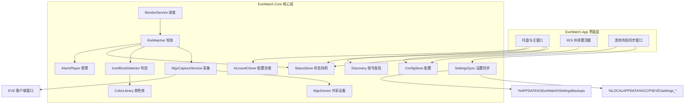
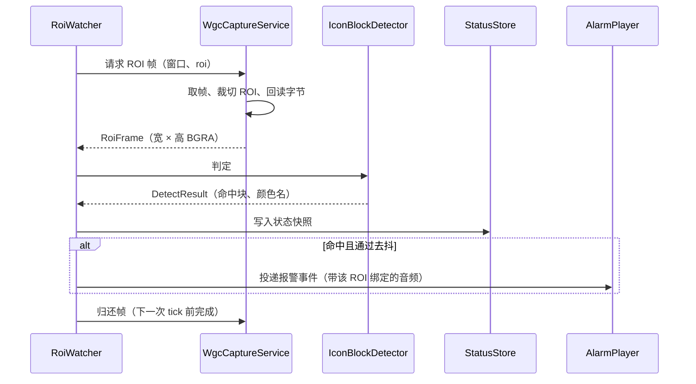
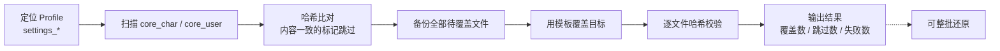
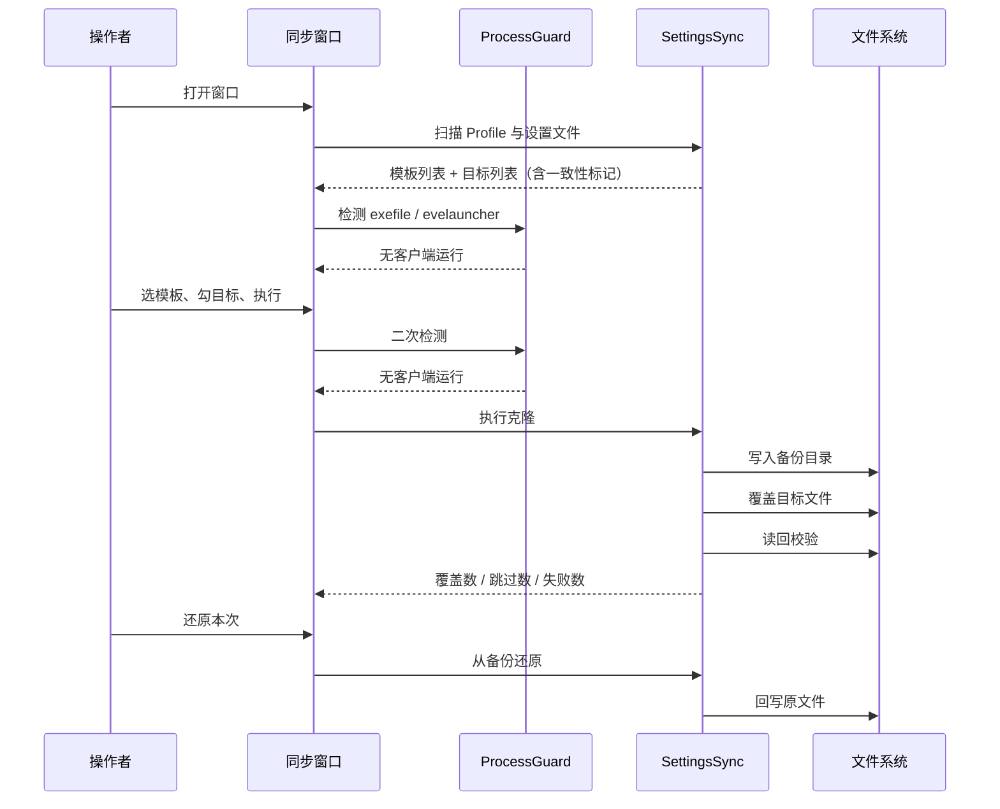

# EveWatch 项目方案

项目：EveWatch（暂定名）　版本：v1.2　日期：2026-10-16　状态：待评审

---

## 1. 设计概述

### 1.1 目的与范围

EveWatch 是本机运行的多开辅助工具，包含两组互不干扰的能力。

第一组是**本地预警**。程序读取 EVE 客户端「本地」频道成员列表左侧的站位图标列，出现敌对颜色图标时用声音与视觉提示提醒玩家。图标颜色由客户端按 standing 自动着色，颜色本身即判断结果。

第二组是**客户端设置同步**。在本机多个 EVE 角色之间同步客户端设置文件（UI 布局、总览、快捷键、窗口位置），使多开客户端的界面保持一致。

两组能力在使用时机上互斥：预警要求客户端处于运行状态，设置同步要求客户端全部退出。

本文档覆盖采集、判定、报警、设置读写、配置、界面与诊断工具的架构与约定。

不在本文档范围内的内容：键鼠输入注入与广播、游戏进程内存读写、对局内自动化、跨机器同步、读取成员名字与人数。设置同步只读写用户目录下的客户端配置，不改动游戏安装目录中的任何程序文件。

### 1.2 需求基线

需求来自口述，以下十条已确认，作为设计输入。

| 编号 | 需求 |
|---|---|
| AR-1 | 判断依据是本地图标列是否出现敌对颜色的图标，不读名字与人数 |
| AR-2 | 多开场景，客户端数量在 10 个量级 |
| AR-3 | 不使用 OCR |
| AR-4 | 采集固定使用 WGC 单一通道，不设分档与降级通道 |
| AR-5 | 对客户端画面只读，不注入、不写游戏进程内存 |
| AR-6 | 每个账号可配置多个 ROI，每个 ROI 独立选择报警音频 |
| AR-7 | 账号列表支持拖动排序，顺序持久化 |
| AR-8 | 颜色库可扩展，支持从截图或屏幕取色新增颜色 |
| AR-9 | 提供客户端设置文件的克隆与还原，覆盖前必须备份 |
| AR-10 | 不实现输入广播 |

AR-5 的表述与早期版本不同。早期版本写作"不写内存"，现在因为 AR-9 需要写入设置文件，把边界收窄为"不写游戏进程内存"。

### 1.3 设计目标与约束

| 编号 | 目标 | 指标 |
|---|---|---|
| G-1 | 报警延迟 | 图标出现到出声 ≤ 500 ms |
| G-2 | CPU 占用 | 10 客户端稳态 ≤ 8% 单核 |
| G-3 | 内存占用 | 常驻 ≤ 300 MB，72 小时无增长 |
| G-4 | 显存占用 | 10 客户端 ≤ 700 MB |
| G-5 | 稳定性 | 72 小时无崩溃；单账号异常不影响其他账号 |
| G-6 | 运行权限 | 免管理员 |
| G-7 | 接入成本 | 新账号从添加 ROI 到开始监控 ≤ 3 分钟 |
| G-8 | 设置同步安全 | 覆盖前先备份；写入后逐文件校验；支持整批还原 |
| G-9 | 设置同步耗时 | 10 个角色的一轮克隆 ≤ 3 秒（含备份与校验） |

G-2 的目标值来自 M1 的实机实测：单账号 3.44 ms/tick、1.03% 单核，按 10 个账号线性外推约 8% [Data-backed]。早期版本写的 3% 是估计值，实测不成立，已上调。G-4 由 WGC 的纹理持有方式决定，推导见 2.5。

G-3 的目标值在 M4 之后上调。WPF 加 .NET 运行时的进程工作集基线就在 200 MB 量级，实测界面启动后 224 MB [Data-backed]；早期版本写的 80 MB 只适用于不带界面的核心层。核心层的实际占用只有几十 MB，这部分目标未变。

### 1.4 术语

| 术语 | 含义 |
|---|---|
| ROI | 图标列所在的矩形区域，逐条框选，典型尺寸约 25×500 像素 |
| 会话 | 一个窗口对应的一组 WGC 对象，包含捕获项与帧池 |
| 命中 | ROI 内检出一个与配置颜色匹配且形状完整的图标块 |
| 去抖 | 连续若干帧命中才判定为需要报警 |
| 丢帧 | 一次 tick 中未能取得有效 ROI 帧 |
| 颜色库 | 参与判定比对的颜色集合，内置四项 EVE standing 色，可增删 |
| 配置克隆 | 把一个账号的 ROI、颜色、音频、启用状态复制到其它账号，作用于本程序配置 |
| 设置同步 | 把客户端设置文件从一个角色复制到其它角色，作用于游戏客户端配置 |
| Profile | `%LOCALAPPDATA%\CCP\EVE\<安装>\settings_*` 目录，一套客户端设置 |
| core_char | 角色级设置文件，含 UI 布局、总览、快捷键 |
| core_user | 账号级设置文件，含窗口位置与尺寸、硬件、分辨率 |

配置克隆与设置同步都涉及"复制一份到多个目标"，但作用对象一个是本程序的配置、一个是游戏客户端的文件，本文档与界面文案中刻意不用同一个词。

---

## 2. 技术方案与效率论证

### 2.1 判定信号为何用像素颜色而非 OCR

客户端已经把 standing 渲染成图标颜色，颜色就是判断结果本身。OCR 要读出名字或数字，再反查 standing 才能得到同一个结论，中间多出字体识别、缩放适配、词表比对三个环节，每一环都会引入误差，而这三环都不产生新的判断能力。

OCR 的失败模式也更难处理。颜色判定若误判，表现为多报或少报一个色块，容易通过去抖和形状过滤收敛；OCR 误判则会把一个名字读成另一个名字，错误类型是"指向了错误的账号"，排障难度高一个量级。

因此判定信号选颜色，不引入 OCR。

### 2.2 采集为何选 WGC

WGC 在遮挡状态下仍可取得窗口内容，不要求目标窗口重绘，这正是多开挂机场景的常态。

| 指标 | WGC | PrintWindow |
|---|---|---|
| 单次采集 CPU | 0.82 ms | 25.5 ms |
| 端到端 ms/tick（10 客户端、500 ms 节拍、含判定） | 3.5 | 29.8 |
| CPU（单核 = 100%） | 7.5% | 59.7% |
| 单帧回读量 | 149 KB（只 ROI） | 32 MB（整窗） |
| 对游戏帧率的影响 | 无 | 强制目标窗口整窗重绘 |

上表全部来自既有项目在同一台机器、同一组 10 个真实客户端上的实测 [Data-backed]。WGC 在采集环节领先约 31 倍，端到端领先约 8 倍。PrintWindow 仅在显存占用为零和不受系统版本限制两点上占优，两者对本项目都不构成约束，因此不采用。

同一次压测还显示，端到端 3.5 ms 中颜色判定只占 0.16 ms [Data-backed]。采集和内存分配是成本主体，判定算法本身留有大量余量。

### 2.3 像素颜色判定的最高效做法

判定管线如下，全程在预分配的缓冲上进行。

```
输入：ROI 的 BGRA 字节，宽 w、高 h，以及复用的标签缓冲 label[w*h]

1. 分类：对每个像素取 (B>>4)<<8 | (G>>4)<<4 | (R>>4) 作为索引，查 4096 项 LUT，
        得到颜色标签写入 label。LUT 在颜色库变更时按 HSV 规则一次性重建。
2. 纵向区间：逐行判断某标签在这一行有没有命中像素，沿 y 方向把连续命中行合并为区间，容许区间内部连续空洞不超过 `rowGap` 行。
3. 横向范围：在每个区间内统计命中像素数，以及该标签的 x 起止。
4. 过滤：丢弃宽 < 5、高 < 5、或命中像素数不足下限的区间。
5. 输出：剩余区间即为命中块，携带颜色名与外接矩形。
```

四种候选做法按每像素成本比较如下。

| 做法 | 每像素成本 | 采用 |
|---|---|---|
| 查表分类 + 纵向区间 | 一次整数查表，标签缓冲复用 | 是 |
| 逐色计算颜色距离 | 每个配置色一次减法、一次平方和、一次比较 | 否 |
| 边缘检测 + 连通域分析 | 高斯模糊、边缘检测、连通域标记，多次遍历且需要队列 | 否 |
| 图标模板匹配 | 归一化互相关，复杂度与模板面积相乘 | 否 |

查表方案的计算量比逐色距离低一个数量级，比边缘检测与模板匹配低两个数量级以上，且全部是整数运算与可预测分支。LUT 每通道量化到 4 bit，共 4096 项、每项 1 字节，合计 4 KB [Expert judgment]。

计数单位从"连通区域"换成"纵向区间"，是 M4 之后的一次修正，起因是实机命中数与肉眼数差得正好是 2 倍。

定位结果：EVE 的站位图标不是实心色块，而是**若干互不相连的同色形状**（准星式边框加内部符号），实测一个图标会被切成 4 段；而分段时的块归属在"第一次相遇"就被定死了——碎片第一次出现时，本体块的历史外接范围还没长到能包住它，于是碎片独立成块。11 个图标报成 22 个，误差恰好 100%。

比误差本身更麻烦的是**形状导向的阈值根本不可靠**：外接矩形填充率对"细线框加小符号"的图标天然很低（实测 0.36，而阈值是 0.35），对实心图标又接近 1。同一个阈值不可能同时服务这两种形状，换一个 standing 符号就可能整体失效；实测那个 0.36 只比阈值高 0.01，任何一点渲染差异都会让整块被丢弃，表现成"数字时对时错"。

纵向区间只依赖"这一行有没有命中像素"。这条 ROI 沿本地成员列表的图标列竖向框选，成员按行等距排列、一行一个图标，所以"竖直方向上有几段命中区间"就等于"有几行成员被命中"。判据与形状完全无关，长宽比与占比阈值因此一并取消，只留"区间内命中像素数不低于下限"这一条与形状无关的噪声门槛。

`rowGap` 的取值有上下两个约束：上界必须明显小于"行距 − 图标高"，否则相邻两个成员的图标会被并成一段；下界要能包容图标内部的空白行。实测本地列表行距 30 px、图标高 22 px，行间空白 8 行，取 3 有足够余量 [Data-backed]。

修正后两次独立验证（对着放大图肉眼数）：6 个图标检出 6、4 个图标检出 4，且 8 帧内区间数与丢弃数完全不变。

### 2.4 查表的构建规则为何用 HSV 而不是 RGB

查找表在运行时只是一次整数查表，但**用什么规则填这张表**决定了会不会漏报。这一条是实机验证后才改的，原始设计用的是 RGB 欧氏距离，实测漏报。

EVE 的站位图标带透明度，叠在不同背景上的绝对亮度差别很大，而色相基本不变。实测数据：本地列表里的友军蓝图标是 `#032076` 与 `#051A5A`，而表示同一 standing 的界面蓝通常是 `#3C78DC`。

| 比对方式 | 图标 `#032076` 与颜色库 `#3C78DC` 的差异 | 结论 |
|---|---|---|
| RGB 欧氏距离（归一化） | 0.300 | 超过 0.16 阈值，漏报 |
| 色相差 | 7.4° | 在 20° 容差内，命中 |

用 RGB 距离时，同一列蓝色图标在实测中命中数为 0；换成色相后同一帧命中 23 个，与截图中可见的图标数量一致 [Data-backed]。

因此建表规则改为：先算像素与颜色库各项的 HSV，再做三段判断。明度低于 0.18 的像素视为背景；饱和度低于 0.18 的归为中性色，在同为中性的项里按明度接近度匹配；其余按色相距离匹配，容差 20°。三个阈值都作为判定参数暴露在配置里。

中性色单独走明度匹配，是为了避免把黑色背景当成深灰图标，同时避免把图标上的白色高光当成浅灰。

#### 2.4.1 量化格必须整格采样，不能只看中心

查找表把每通道压到 4 bit、共 4096 格，运行期一次整数寻址就能拿到标签。但**格子的标签怎么定**这一步出过一次严重错误：原实现只取格子中心的颜色判定，在暗色低饱和区域产生了系统性误报。

实测案例：界面上的舰船渲染有大量暗褐像素，例如 `#3A2F25`，实际色相是 **28.6°（暗褐）**；敌对红是 0°、容差 20°，本来**不该**匹配。但该像素落在 R 48–63 / G 32–47 / B 32–47 这一格，格子中心是 `(56,40,40)`，算出来的色相是 **0°（纯红）** —— 于是整格暗褐像素都被贴上"敌对红"，在明明没有红色的区域持续误报。

根因：暗色低饱和处，R/G/B 各差几个数色相就翻几个色区。**逐通道在 RGB 空间做量化，之后又在量化空间里谈色相，两者不兼容。**

改法：建表时对每格做 **27 个格点穷举采样**（每通道的 min / mid / max 三相组合），要求所有点一致落在同一颜色的容差内，否则该格标为不匹配；只要有任何一点落在背景档（明度低于下限），整格作废。代价是边界格子被保守地判为"不匹配"，图标边缘的抗锯齿像素可能不计入 —— 但图标主体是实心高饱和区，不受影响。

成本落在构建期而非运行期：4096 格 × 27 点 × 颜色数，只在颜色库变更时跑一次，量级毫秒。运行期仍是每像素一次整数查表，与修正前完全一致 [Data-backed]。

两项验证：

| 方式 | 内容 | 结果 |
|---|---|---|
| 合成图回归 `--detect-selftest` | 3 个真图标（`#AD0606` / `#8B1010` / `#5A0A0A`，间距 30）+ 2 段实测误报色（`#3A2F25` / `#3E1E05`） | 恰好 3 个命中，暗褐零误报 [Data-backed] |
| 实机复核 | 同一组坐标：误报区（库存窗口舰船页）与真图标区（本地列表） | 误报区 2 → 0；真图标区 6 个检出 6、4 个检出 4 [Data-backed] |

合成图回归保留在自检工具里：真实客户端有没有敌对不由我们控制，而这条回归必须能随时复验。

### 2.5 单一采集通道的代价

选定 WGC 单一通道后，显存占用随账号数线性增长，这是本方案必须接受的成本。WGC 的帧池为每个会话保留两张窗口尺寸的纹理，按 BGRA 每像素 4 字节计算：

| 客户端分辨率 | 单会话显存 | 10 账号显存 |
|---|---|---|
| 1920×1080 | 约 16 MB | 约 170 MB |
| 2560×1440 | 约 29 MB | 约 295 MB |
| 3840×2160 | 约 66 MB | 约 660 MB |

另一项代价是窗口最小化或被系统停止渲染时取不到帧。WGC 在这种情况下不提供新帧，程序只能跳过该帧并计数，无法通过换通道规避。

第 8 节把这两项写入非功能设计，并在 M1 用实机数据核对。

---

## 3. 系统架构

### 3.1 架构总览

系统分为界面层与核心层。核心层不依赖任何界面框架，可被命令行诊断工具复用。界面层只做展示与交互，通过状态快照读取核心层数据，通过配置写入下发指令。



界面层包含托盘主窗口、ROI 并排置顶窗与游戏布局同步窗口。核心层自下而上依次是共享设备、采集服务、轮询、判定与报警，另有一条独立的设置同步支路。设置同步支路不接触采集与判定，只读写文件系统。

### 3.2 组件职责与边界

| 组件 | 拥有 | 明确不拥有 | 依赖方向 |
|---|---|---|---|
| Discovery | 枚举目标进程窗口，产出账号台账与窗口句柄 | 不做采集与判定 | 无 |
| MonitorService | 按账号启停轮询线程，多账号错峰 | 不读像素 | Discovery、RoiWatcher |
| RoiWatcher | 单个 ROI 的定时采集、判定、状态写入 | 不操作 D3D 对象 | WgcCaptureService、IconBlockDetector、StatusStore、AlarmPlayer |
| WgcCaptureService | 会话生命周期、ROI 裁切与回读、限帧、丢帧计数 | 不判定颜色 | WgcDevice |
| WgcDevice | 进程内唯一的 D3D11 设备与串行访问门 | 不感知业务语义 | 系统 API |
| IconBlockDetector | 从 BGRA 字节中找出图标块并匹配颜色 | 不发起采集，不持有颜色库 | ColorLibrary |
| ColorLibrary | 颜色增删、LUT 重建、颜色名与色值映射 | 不做判定 | 无 |
| AlarmPlayer | 播放声音、弹出提示、去抖与冷却 | 不判定颜色 | 系统音频 API |
| AccountCloner | 把一个账号的配置复制到其它账号 | 不接触游戏文件 | 无 |
| SettingsSync | 扫描、比对、备份、覆盖、校验、还原客户端设置 | 不做输入相关操作 | 文件系统 |
| ConfigStore | 配置的读写、校验、热生效 | 不做业务判断 | 文件系统 |
| StatusStore | 线程安全的状态快照 | 不持有采集资源 | 无 |

依赖方向全部单向，不存在环。

### 3.3 一条 tick 的数据流

一个 tick 从 RoiWatcher 的定时器开始，到状态写入与可能的报警投递结束。



取帧失败时，采集服务返回空结果并累加该账号的丢帧计数，轮询线程跳过本帧，直接进入下一个间隔。

### 3.4 代码组织

```
EveWatch/
├─ docs/                       设计文档
├─ mockup/                     界面原型
└─ src/
   ├─ EveWatch.Core/           核心层，无界面依赖
   │   ├─ Capture/             WGC 会话、共享设备、ROI 裁切与回读
   │   ├─ Detect/              颜色 LUT、纵向区间扫描、图标块判定
   │   ├─ Palette/             颜色库与 LUT 构建
   │   ├─ Watch/               轮询与调度
   │   ├─ Alarm/               声音、弹窗、去抖与冷却
   │   ├─ Cloning/             账号配置克隆
   │   ├─ Settings/            客户端设置同步（扫描/比对/备份/覆盖/还原）
   │   ├─ Discovery/           窗口枚举与账号台账
   │   ├─ Status/              状态快照
   │   └─ Config/              配置模型与读写
   ├─ EveWatch.App/            界面层，托盘常驻
   └─ EveWatch.Selftest/       命令行诊断与压测工具
```

### 3.5 技术选型

| 项 | 选择 | 理由 |
|---|---|---|
| 运行时 | .NET 8，目标框架 net8.0-windows10.0.26100.0 | WGC 的 COM 互操作需要该版本起的目标框架；既有项目已验证 [Data-backed] |
| 界面 | WPF，托盘常驻，主窗口与浮窗按需创建 | 框选需要拖框与缩放显示；常驻阶段不创建窗口以压低内存 |
| 采集 | WGC（Windows.Graphics.Capture）配合 Vortice.Direct3D11 与 Vortice.DXGI | WGC 提供窗口级捕获，Vortice 提供纹理裁切与回读所需的互操作。既有项目使用的 Vortice 版本为 3.8.3 [Data-backed] |
| 判定 | 自实现颜色 LUT 与纵向区间扫描，不引入图像处理库 | 见 2.3 的成本比较。省去数十 MB 依赖与原生初始化成本 [Expert judgment] |
| 音频 | NAudio | 支持 wav 与 mp3，既有项目已使用 [Expert judgment] |
| 文件校验 | System.Security.Cryptography 的 MD5 | 逐文件比对与写后校验，来源为既有 EveSync 项目的实现 [Data-backed] |
| 配置 | JSON，三个文件分工 | 可读可手改，便于排障 |
| 角色名解析 | 打开同步窗口或切换范围时自动进行 | 调用 ESI 的 universe/names 接口批量解析角色 ID，结果落本地缓存，已缓存的 ID 不再请求；离线或限流时列表显示 `#ID`，不影响克隆 [Data-backed] |

版本号未在既有项目中确认的依赖，在实现阶段以实际锁定版本为准，本文档不预设。

---

## 4. 预警模块设计

### 4.1 WGC 采集服务

采集服务的效率取决于四件事：只搬运需要的像素、不重复创建对象、不产生多余帧、及时归还帧。

| 要点 | 做法 | 收益 |
|---|---|---|
| 设备复用 | 进程内一个 D3D11 设备，多线程通过串行门访问 | 避免每账号一个设备带来的对象与内存开销 |
| 会话划分 | 每个窗口一个捕获项与一个帧池 | 同一窗口的多条 ROI 共用一次取帧 |
| 裁切 | 回读到暂存纹理时传入 ROI 的矩形 | 回读量从整窗降到 ROI，实测差 216 倍 [Data-backed] |
| 暂存纹理 | 每会话一张，尺寸取该窗口的最大 ROI，全程复用 | 去掉每帧创建纹理的开销 |
| 回读缓冲 | 复用预分配的托管字节数组 | 运行期零托管分配，避免大对象堆与二代回收 |
| 限帧 | 帧池的最小更新间隔设为 tickMs 的一半 | 抑制程序用不上的帧生产 |
| 光影 | 关闭光标捕获与窗口边框 | 去掉不需要的合成工作 |
| 归还 | 每帧回读完成后立即归还给帧池 | 帧池及时补充，减少取帧落空 |

一个窗口只有一路会话，该窗口下的多条 ROI 在同一帧上分别裁切。账号勾选 3 条 ROI 时，采集次数仍是每 tick 一次。

线程模型上，每个已启用账号对应一个轮询线程，优先级设为 BelowNormal。D3D11 的即时上下文不保证线程安全，因此在 WgcDevice 内用一把锁串行化纹理操作；单次操作在毫秒以内，10 个账号的采集在时间轴错开后不会互相等待 [Expert judgment]。

会话建立失败或窗口句柄失效时，服务标记该账号为不可监控并上报，不重试创建，直到 Discovery 发现新句柄或用户重新框选。

### 4.2 颜色与判定

判定管线的步骤见 2.3。以下补充实现约定。

颜色库是全局的，每个 ROI 引用其中若干项。库内每一项包含 id、显示名、色值、是否内置。内置四项不可删除，自定义项可增删。颜色库变更时重建 LUT，LUT 构建包含量化与阈值比较，全部在配置加载或颜色改动时一次完成。

LUT 在每次判定中只读。标签缓冲、游程缓冲与候选块数组都按 ROI 尺寸预分配并复用，运行期不产生新的托管数组。

判定函数的输入是一段 BGRA 字节与宽高，输出是命中块的外接矩形与颜色名。它不持有任何采集对象，可以脱离采集单独测试。

命中颜色的展示与判定解耦：每个 ROI 卡片上列出颜色库全部颜色，勾选表示该颜色参与此 ROI 的报警判定。

### 4.3 轮询与调度

每个已启用账号对应一个轮询线程，按固定的 tickMs 间隔工作，间隔默认 200 ms。报警要连续 2 帧命中才升级，所以图标出现到出声是 0.2~0.4 秒，落在 G-1 的 500 ms 预算内。节拍取 200 而不是 400，是因为 400 ms 配 2 帧去抖最长要 0.8 秒才出声，超出指标；实测每账号 CPU 只有 1% 量级，翻倍后余量仍然充足。

账号下的多条 ROI 在同一次唤醒中依次处理，共用一次窗口取帧。任一 ROI 判定异常只跳过该 ROI，不影响同账号的其它 ROI。

未勾选的账号不创建线程，不是创建后丢弃结果。

所有线程在启动时按序号分配错峰延迟，第 i 个账号的首次触发延后 i × (tickMs / N)。这样把各账号的采集时刻在时间轴上摊开，避免同一瞬间争抢帧池与 CPU。

### 4.4 报警

报警音频按 ROI 配置，同一账号下的不同 ROI 可以绑定不同音频。

音频来源有两种：内置预设与本地文件。内置预设共五项，由程序合成波形，不依赖外部文件：

| 预设 | 特征 |
|---|---|
| 警报长鸣 | 800 Hz 长音 ×2 |
| 短促嘀声 | 1200 Hz 短音 ×3 |
| 三段上升 | 520 / 700 / 900 Hz |
| 低沉蜂鸣 | 180 Hz 方波长音 |
| 机械提示 | 620 Hz 双击 |

本地文件支持 wav 与 mp3，逐 ROI 选择，只在本机读取与播放。

去抖要求连续 2 帧命中同一颜色才升级为报警。冷却按账号独立计时（**不是按 ROI**），默认 2 秒，冷却期内重复命中只更新状态不出声；这意味同一账号的多条 ROI 会互相抑制，2 秒内只有第一次命中会出声。全局静音只抑制声音，事件仍然记录。

**声音全局只有一个通道，谁先触发谁占用，不排队。** 多开场景下每个账号各占一路的话，十个客户端同时命中就是十路声音叠加，既刺耳又听不出是哪个号出事。后来的账号在其声音播完前一律让位，让位会照常写入事件栏（副文本注明是谁在占用），且冷却计时从本次开始，仍在命中就会在下个冷却周期再抢一次。占用者判定与接管在同一把锁内完成，否则多账号线程同时命中时会出现两个账号都认为自己该播的窗口。同一账号的重复报警视为续播，允许打断自己。交接下一路声音的几毫秒里通道同样处于预留状态（旧的一路已停、新的一路还没占位），否则别的账号线程会从这个空档挤进来，形成两路叠音。判定与音效在独立线程运行，不阻塞轮询线程。

### 4.5 克隆设置

把一个账号的配置复制到其余账号，用于批量接入。可选的克隆项分四类：

| 克隆项 | 内容 |
|---|---|
| ROI 列表与区域 | 每条 ROI 的名称、坐标、尺寸、启用状态 |
| 命中颜色 | 每条 ROI 引用的颜色库项 |
| 报警音频与音量 | 每条 ROI 的音频来源与音量 |
| 启用状态 | 账号是否参与监控，默认不克隆 |

未勾选的克隆项在目标账号上保持不变。目标账号原有的 ROI 在克隆「ROI 列表与区域」时被整体替换。

克隆只作用于本程序配置文件，不接触游戏客户端。

---

## 5. 客户端设置同步模块设计

### 5.1 能力来源与边界

本模块的能力来自既有的 EveSync 项目，其 `EveSync.Core/Settings` 下的实现已经过使用验证 [Data-backed]。移植时保留其处理顺序与安全约束，去掉与输入广播相关的一切代码。

模块只处理两类文件：

| 文件 | 位置 | 内容 |
|---|---|---|
| `core_char_<角色ID>.dat` | Profile 目录 | UI 布局、总览、快捷键 |
| `core_user_<账号ID>.dat` | Profile 目录 | 窗口位置与尺寸、硬件、分辨率 |

文件名解析用正则限定为 `^core_(char|user)_(\d+)\.dat$`，跳过 `core_char__.dat` 一类畸形残留，避免整次扫描失败。

### 5.2 处理流程



各步骤的约束如下。

定位阶段枚举 `%LOCALAPPDATA%\CCP\EVE` 下每个安装目录中的 `settings_*` 子目录，每个子目录即一个可选 Profile。

比对阶段对每个目标文件与模板文件做 MD5 比较。内容一致的项既不覆盖也不备份，避免无意义的写入与备份膨胀。

备份阶段把所有待覆盖文件复制到 `%APPDATA%\EveWatch\SettingsBackups\<安装>_<Profile>\<yyyyMMdd_HHmmss_fff>\`。时间戳精确到毫秒，避免同一秒内两次备份命中同一目录。备份失败时整批操作中止，不覆盖任何文件，返回失败结果。

覆盖阶段逐个复制并即时校验。单文件失败不中断其余文件，失败原因记入结果。

还原阶段把本次备份的实际覆盖项复制回原位，返回还原数量。

### 5.3 前置条件与守卫

写入客户端设置有两个硬性前提，违反任一前提都会让改动失效或造成损失。

**客户端必须完全退出。** EVE 客户端在运行期间持有设置的内存副本，退出时会把副本回写磁盘，覆盖掉程序写入的内容。模块在每次打开与每次执行前调用进程守卫，检测 `exefile` 与 `evelauncher`；检测到任一进程存在时，执行、预览、还原三个操作全部禁用，并在窗口内给出明确提示。

**目标与模板的分辨率应当一致。** `core_user` 中包含窗口位置与尺寸，跨分辨率克隆会让窗口落到屏幕外。这一点无法自动判断，界面以常驻警告的形式提示，不阻塞操作。

另有一条副作用需要在界面上明示：`core_char` 中包含聊天频道设置，克隆会使多个角色共用同一套频道配置，在本地频道中造成 alt 暴露。这是操作者需要自行判断是否接受的风险。

### 5.4 同步时序



---

## 6. 界面设计

界面原型见 [mockup/ui-layout.html](../mockup/ui-layout.html)。

### 6.1 主窗口布局

主窗口为三栏结构，上方标题栏与工具栏，下方状态栏。

```
┌ 标题栏 ── EveWatch · 本地预警控制台 ───────────── ─ □ ✕ ┐
├ 工具栏 ── [开始监控][全局静音] │ [客户端预览 ⚙][频道预警] │ [ROI 并排]
│            [布局同步][克隆设置] │ 汇总胶囊 [⚙]
├────────────┬──────────────────────────┬─────────────────┤
│ 客户端 10  │ 账号详情                  │ 事件            │
│ [全选][反选]│  头部：账号 / 采集 / 帧率  │ 时间 + 账号     │
│ ⠿ ▣ 账号 1 │  ROI 卡片 × N            │ + 事件 + 备注   │
│ ⠿ ▣ 账号 2 │   ├ 区域与重框            │                 │
│ ...        │   ├ 命中颜色 + 自定义      │                 │
│            │   ├ 报警音频 + 试听        │                 │
│            │   └ 音量 / 最近命中        │                 │
├────────────┴──────────────────────────┴─────────────────┤
│ 采集 WGC │ 节拍 400ms │ CPU │ 内存 │ 显存 │ 丢帧 │ 配置文件│
└─────────────────────────────────────────────────────────┘
```

工具栏左侧按三组排布：运行控制（监控 / 静音）、客户端相关（客户端预览与其设置、频道预警）、ROI（并排窗）；右侧固定账号工具（布局同步、克隆设置）、监控汇总胶囊与全局设置入口。

左栏列出全部客户端，中栏展示选中账号的 ROI 列表，右栏是事件流。三栏自适应，窗口宽度低于阈值时隐藏事件栏。

需要说明的是，界面上的操作动词只有两个与 ROI 相关：`新增 ROI` 与 `重框`。前者创建一条新 ROI，后者重画已有 ROI 的矩形并保留其颜色与音频设置。早期版本里"标定""重新标定""重新框选""开始标定"等多个近义入口已收敛掉。

### 6.2 账号列表

每行包含拖动把手、启用开关、角色名、ROI 数、实际帧率、丢帧数、敌对标记。

列表内容来自账号发现：枚举 `exefile` 进程的可见顶层窗口，**只认标题形如 `EVE - 角色名` 的窗口**。客户端在启动与登录 / 选择角色阶段标题只有 `EVE`，那时还没有角色名可用，不能建账号条目——否则客户端每重启一次，列表里就会凭空多出一个叫 `EVE` 的账号，而且它一旦被写进配置就不会自己消失。已经写进配置的条目也不随客户端关闭而删除（否则每次关游戏就丢配置），要清掉只能关掉程序后编辑 `evewatch.json`。

**选中态必须显式做出来。** 列表项的容器模板是裸 `ContentPresenter`，不带任何选中视觉，所以点击后除了右栏内容变化之外看不出选了谁。选中行的底色改为略亮的一级表面、描边改为主色；敌对行也保留告警红底，此时描边仍用主色，让"选中"和"告警"两个状态同时可见，而不是互相覆盖。

拖动排序直接拖动行，松手后写入界面状态文件，重启后顺序保留。表头的全选与反选作用于全部账号的启用状态。**双击某一行把焦点交给该账号的客户端**，与并排窗双击同一套语义：需要看这个号的画面时不用去任务栏翻。

### 6.3 ROI 卡片

每条 ROI 一张卡片，包含：

| 区域 | 内容 |
|---|---|
| 头部 | 名称（双击重命名，回车提交、Esc 还原、清空则退回原值）、命中徽标、预览、重框、启用开关、删除 |
| 预览 | 图标列缩略图，命中时对应色块变红 |
| 区域 | `x / y / w / h` 只读文本 |
| 命中颜色 | 颜色库全部颜色的可点选色块，末尾一个虚线的「自定义」入口 |
| 报警音频 | 下拉选择内置五项或自定义文件，附试听按钮 |
| 音量 | 滑块，0 到 100 |
| 最近命中 | 时间与累计次数 |

卡片的空白处**双击即切到该账号的客户端**。名称双击是重命名、控件各自吃掉点击，所以「点空白处双击」与「点名称/控件」不会互相干扰。切焦点固定为一次交互的最后一步，之后不再对本程序窗口做任何前台操作，否则会把刚交出去的焦点抢回来。

### 6.4 ROI 并排置顶窗

一个独立的浮动窗口，**按账号分组**：一个账号一组，组内该账号的各条 ROI 并排显示各自的实时画面。同一个账号的多条 ROI 不会被拆成互不相干的独立条目。

分组是必要的。原先按 ROI 平铺时，同一个账号的 A、B 两条 ROI 会成为两个看不出关系的相邻列，多开场景下账号一多就分不清哪几列属于同一个客户端；而"某个号被盯上了"这个判断本来就是账号维度的。现在组头显示账号名并横跨整组，坐标归属一眼可见。

**组的顺序与左栏账号列表完全一致**，包括拖动排序的结果：两边都走同一份 `accountOrder`，所以看到的第一个组就是列表里的第一个账号。顺序也算进内容签名，窗口开着时拖动左栏，并排窗在下一拍就跟着重排，不需要关掉重开。

每一列显示该条 ROI 的**实时画面**。显示尺寸 = 原始像素 × 缩放；缩放默认 0.5，在窗口内用 **Ctrl + 滚轮**在 0.2 到 1.5 之间调整，结果写入界面状态、下次打开沿用。

早期实现是按原始像素 1:1 显示的，理由是"图标块大小与客户端一致、便于肉眼比对"。实测下来这个理由站不住：一条 59×528 的 ROI 会让窗口高过 600 px，多账号并排后整块浮窗占据小半个屏幕，反而挡住游戏画面——而并排窗的第一诉求是"不挡事地扫一眼"。改成默认 0.5 后，整体尺寸降到约四分之一。缩放做成手势而不是控件，是为了不在无边框窗口里放任何按钮（见下）。

列宽随画面宽度自适应，窗口尺寸随内容撑开，上限为工作区 90% 宽、85% 高，超出部分横纵滚动。

组的宽度**只由 ROI 列决定，不由账号名决定**。账号名用等宽字体约 60 px，而一条 45 px 宽的 ROI 缩到 0.5 只有 28 px；若让名字参与撑宽，它会成为宽度下限，缩放画面时窗口宽度纹丝不动。所以账号名按列宽之和截断显示。同理，右上角的统计浮层放在 `Canvas` 里——`Canvas` 的期望尺寸恒为 0，统计文字再长也不会影响窗口宽度（位置在尺寸变化时手工算，因为 `Canvas` 不支持右对齐）。

画面来自核心层的画面快照仓库，数据通路是：轮询线程采集到 ROI 帧后，在判定之后把帧内容复制一份发布出去；界面按 400 ms 的节奏取最新一帧写入位图。**拷贝只在并排窗打开期间发生**，窗口关闭立即停止并清空，常驻状态下不产生任何额外开销。超过 3 秒没有新帧的列显示「无画面」占位——监控停止、窗口被最小化时会看到这个状态，而不是挂着一帧旧画面。

渲染上有两条硬要求，都直接决定这个窗口卡不卡：

1. **不开 `AllowsTransparency`。** 开启它会把窗口变成分层窗口，WPF 对分层窗口会退回软件渲染；而本窗口每 400 ms 就要重画全部 ROI 位图，软件渲染下就是肉眼可见的卡顿。窗口是纯矩形、不需要圆角与异形，分层窗口只带来代价。
2. **帧没换过就不重写。** 窗口的 400 ms 刷新节奏与轮询节奏不保证对齐，不对齐时同一帧会被反复写进位图，每次写入都会触发整窗重绘。每列记住上次写入的帧时间戳，相同就跳过。

窗口**完全无边框**：没有标题栏，没有外框，没有圆角，只有一层底色，贴在游戏窗口旁边时不会多出任何描边或空白。

因为没有标题栏，交互重新安排。**移动**靠拖动窗口任意位置，左右键都能拖，但两者机制不同：左键按下只记录起点，移动超过拖动阈值才进入拖动，因为左键同时承担双击跳转，按下即拖动会吃掉消息循环导致双击失效；右键没有其它用途，按下即可直接拖动。两条路径都不使用 `Window.DragMove()`：它内部要求左键处于按下状态，右键调用会抛 `InvalidOperationException`，而且它会立刻进入嵌套消息循环吃掉双击的第二下；改为自己按位移搬窗口。位移必须按屏幕坐标计算（`PointToScreen`），用相对窗口的坐标会因为窗口自身在移动而变成自反馈；同时要按 DPI 比例换算回 WPF 单位。**缩放**用 Ctrl + 滚轮。

事件处理器挂在 `MouseDown` / `MouseUp` 上，不能挂 `MouseLeftButtonDown` / `MouseLeftButtonUp`——后者只对左键触发，挂在它们上面时右键分支是死代码（这一条踩过一次）。**开关**统一由主窗口工具栏的一个按钮承担，窗口内部不提供任何关闭控件：按钮文案随状态变化，关闭时是「开启 ROI 并排」、打开时是「关闭 ROI 显示」，打开状态下按钮带底色与描边，本身就是状态指示。Esc 是窗口内的便利补充，但它不是唯一出口，随时可以从主窗口关掉。

「账号数 · 路数 · 报警数」的统计做成了低透明度的悬停浮层，平时不占视线、不占布局。没有任何可显示 ROI 时给一句文字提示，而不是留一个纯黑空窗。

按钮状态只在窗口的 `Closed` 事件里复位，不在点击处理里复位。这样无论关闭来自工具栏按钮还是窗口内的 Esc，状态都一致，不会出现按钮文案和实际状态不符。

窗口尺寸随内容自适应，上限为工作区的 90% 宽、85% 高，超出部分横纵滚动。**位置与缩放都跨会话保留**，两处容易踩空：

1. **落盘时机**。拖动结束时与窗口关闭时各写一次界面状态。只在关闭时保存的话，程序异常退出、或者窗口一直开着直到整个程序被结束，这次拖到哪就白拖了。
2. **恢复时机**。位置必须在内容建好、窗口尺寸定稿之后再设。`SizeToContent` 的窗口打开时会先按尚未撑开的尺寸定位一次，早于内容就设 `Left`/`Top`，位置会被那次定位盖掉——现象就是"每次打开都要重新摆一次"。恢复的坐标还要夹在虚拟屏幕内（至少留 40 个单位可见），否则显示器拔掉或分辨率变小后，旧坐标会把窗口送到看不见的地方。

命中时该条 ROI 描红，同时它所在的整组也描红——一个账号有任一条 ROI 命中，整个组都能被看见，这与"这个号被盯上了"的语义一致。双击组内任意位置会把主窗口切到对应账号，并把对应客户端窗口置前。

抢焦点这件事受 Windows 前台锁限制，`SetForegroundWindow` 会被静默拒绝。实现里按三级处理：目标已是前台直接返回；最小化则先 `SW_RESTORE` 再抢；仍失败则退一步用 `BringWindowToTop` + `SetWindowPos(HWND_TOP, SWP_NOACTIVATE)` 把它提到 Z 序顶部——至少让它盖在其它窗口之上。无论成败都会写一条日志，不静默失败。这里刻意没有使用 `AttachThreadInput`：把本进程的输入队列附到游戏进程的窗口线程上，超出了"只读屏幕"的行为边界，收益也不值得这个风险。

> 本节的「显示真实画面」是 M4 之后的修订。早期原型里每列画的是一组按颜色库着色的示意方块，那只是占位，无法反映实际画面；并排窗的价值恰恰在于看到真东西。

### 6.5 克隆设置

工具栏按钮打开一个对话框。

**基准账号在窗口内可选**（下拉框，默认取主窗口当前选中的账号）；**目标账号多选**（复选框列表，带「全选 / 反选 / 清空」，实时显示已选数量）。切换基准账号时，目标列表自动排除基准账号本身，并保留已勾选的目标——否则只是想换个基准看一眼，勾了一半的目标就得重勾。确认按钮显示目标数量（「克隆到 N 个账号」），未选目标或未勾任何克隆项时禁用。

四个克隆项以复选框呈现：

| 克隆项 | 默认 | 内容 |
|---|---|---|
| ROI 列表与区域 | **不勾选** | 每个 ROI 的名称、坐标、尺寸、启用状态 |
| 命中颜色 | 勾选 | 每个 ROI 判定的 standing 颜色 |
| 报警音频与音量 | 勾选 | 每个 ROI 独立绑定的音频与音量 |
| 启用状态 | 不勾选 | 账号是否参与监控 |

**ROI 之所以默认不克隆**，是因为它的坐标是相对窗口内容区的，只有目标账号的游戏内界面布局与基准账号一致时才成立。这一条来自实机教训：把带 ROI 的配置克隆到界面排布不同的客户端后，坐标落到了库存窗口的舰船页上，那里的暖色渲染被误判成敌对红，产生了无从解释的误报（见 2.4.1）。默认关闭让用户在确认布局一致后主动打开，而不是默认继承一组可能失效的坐标。该项下方常驻一句说明，把这个前提写在用户看得见的地方。

底部说明目标账号的对应设置会被覆盖、未勾选项保持不变。

### 6.6 游戏布局同步窗口

独立浮动窗口，内容分五段。

| 区段 | 内容 |
|---|---|
| 标题栏 | 拖动把手、标题、客户端运行状态胶囊、关闭 |
| 工具行 | 源 Profile、目标 Profile、范围分段按钮（角色 / 账号）、重新扫描 |
| 警告条 | 客户端必须关闭、聊天频道 alt 暴露、分辨率一致三条提示；客户端运行中时转为红色并锁定 |
| 主体 | 左「模板（单选）」，右「目标（多选）」附全选 / 反选 / 清空；行首是名称与 `#ID`，第二行是文件名、大小与修改时间，行尾是 `一致` 或 `待覆盖` 徽标 |
| 底部 | 状态统计行、预览、执行克隆、备份管理、还原本次，以及实时日志区 |

**名称必须显示出来，ID 是给机器看的。** 只列 `#2122157380` 和 `core_char_2122157380.dat` 时，选模板全靠猜。角色维度在打开窗口与切换范围时调用 ESI `universe/names` 批量解析角色 ID，结果写入 `%APPDATA%\EveWatch\character-names.json` 缓存，之后离线也能显示；离线且无缓存时回退为 `#ID`，解析失败只写一条日志，不影响克隆。

账号维度（`core_user_*`）的 ID 是账号 ID，ESI 的 names 接口不收录，因此名称**可编辑**，用于给账号起别名，别名存在 `evewatch.sync.json` 的 `accountAliases` 里，改回默认文本视为清除。

### 6.7 颜色提取器

从 ROI 卡片的「自定义」入口打开，三条取色路径汇聚到同一份颜色值。

| 路径 | 说明 |
|---|---|
| ROI 截图取色 | 把当前 ROI 的画面放大成像素网格，单击任一像素取该点颜色 |
| 屏幕取色 | 调用系统取色接口，在屏幕任意位置吸色，可吸到游戏画面 |
| 手动输入 | HEX 与 RGB 双向联动，输入非法格式时高亮提示 |

右侧实时显示大色块、HEX 值与来源标注，可命名。底部列出颜色库全部条目，自定义项带删除按钮。确认后颜色入库并自动勾选到当前 ROI。

方案里原本还写了第三条取色路径「屏幕取色」。实现阶段发现 Windows 的取色接口在 WPF 里没有对应封装，从系统层面拿到任意位置的屏幕像素需要另做一次全屏捕获或调用第三方接口，收益不足以承担这份复杂度与权限成本，因此**没有实现**。界面上保留像素网格与手动输入两条路径，并在提取器底部给出说明。这是与早期设计的已知差异。

### 6.8 视觉规范

整体为深色仪表盘风格，石墨底配单一高饱和主色，红色只用于敌对与阻断状态。

| 类别 | 取值 |
|---|---|
| 背景 / 面板 / 层级 | `#0a0d10` / `#11161b` / `#151b21` |
| 主色 / 悬停 | `#f0a02a` / `#ffb545` |
| 敌对与阻断 | `#ff4d4d` |
| 正文 / 次级 / 弱化 | `#e3ebf2` / `#8a98a6` / `#5a6672` |
| 显示字体 | Bahnschrift（Windows 自带，标题与数字） |
| 正文字体 | Segoe UI Variable Text + Microsoft YaHei UI |
| 等宽字体 | Cascadia Mono（角色名、坐标、ID、日志） |
| 圆角 | 4 / 6 / 10 px |

应用图标为 `Assets/evewatch.ico`：石墨渐变圆角方底 + 琥珀色四角准星与中心点。**多尺寸单文件（16 / 24 / 32 / 48 / 64 / 128 / 256），每帧各自绘制而非由大图缩放**，否则 16×16 的托盘图标会糊成一团。同一份文件三处复用：`ApplicationIcon` 供 exe（任务栏、Alt+Tab、资源管理器）、`Resource` 供主窗口 `Icon`、以及托盘 `NotifyIcon`（按 16×16 取最接近的一帧）。

图标统一使用 Lucide，以内联 SVG 嵌入，不依赖网络。背景为渐变加网格纹理，不使用纯色平铺。

### 6.9 客户端分组切换

客户端预览设置 → 「客户端分组与快捷键」：

- 可创建多个分组，组内账号顺序即循环顺序，支持上移 / 下移 / 移除
- 组内客户端列表实时标记「未运行」：客户端没启动时名称变暗并显示灰色角标
- 每个分组单独绑定「下一个客户端」「上一个客户端」全局快捷键
- 切换起点以当前前台 EVE 客户端为准；前台不是客户端时回退到列表选中项，避免手动切换窗口后与列表选中不一致
- 当前角色未运行（离线）时直接跳过，从它在组内的位置继续向后 / 向前找下一个在线客户端
- 切换只在组内当前可见（在线）的客户端之间循环，离线成员自动跳过
- 当前账号不在组内时：下一个从组内首个可见客户端开始，上一个从最后一个开始
- 组内没有可见客户端时不切换，事件栏提示（5 秒冷却）
- 原有全局「下一个 / 上一个账号」保留，继续在全部可见账号中循环
- 分组与快捷键写入 `evewatch.json` 的 `clientGroups` 与 `hotkeys`；删除分组时同步清理其快捷键

### 6.10 客户端预览实验（DWM 缩略图）

主工具栏「客户端预览」打开一个置顶预览窗，用 `DwmRegisterThumbnail` 把所有运行中的 EVE 客户端直接合成到窗口中：

- 单个目标窗口内注册多个 DWM 缩略图，按 4 列网格排列，每格 240×135，账号名显示在缩略图下方
- 点击缩略图激活对应客户端；窗口可拖动、可缩放，Esc 或 ✕ 关闭
- 不经过 WGC 取帧，不复制帧数据，画面完全由桌面窗口管理器合成

实测环境：10 个运行中的客户端、20 个 ROI 同时监控，各采样 10 秒：

| 状态 | CPU 时间 | 单核占用 | 进程内存 |
|---|---|---|---|
| 预览窗打开 | 1047 ms / 10 s | 10.5% | 244.7 MB |
| 预览窗关闭 | 1062 ms / 10 s | 10.6% | 246.7 MB |

预览本身的开销在噪声范围内，内存没有可测量的增长。CPU 主要来自既有的 ROI 监控，而不是缩略图。

限制与后续：

- 最小化窗口的 DWM 缩略图可能停止更新，需要还原窗口或改用 WGC
- 原型为固定网格，尚无逐格拖动、缩放、隐藏当前客户端、单格透明度
- 依赖桌面合成（Win10/11 默认开启）
- 相比 WGC 全窗采集，DWM 不会新增采集会话与帧拷贝，适合多开缩略图；需要像素级分析时仍走 WGC

---

## 7. 数据与配置设计

### 7.1 配置文件划分

| 文件 | 内容 | 位置 |
|---|---|---|
| `evewatch.json` | 功能配置：进程名、节拍、颜色库、判定参数、账号与 ROI、快捷键、客户端分组 | 程序目录 |
| `evewatch.ui.json` | 界面状态：账号顺序、浮窗位置、事件日志保留天数 | `%APPDATA%\EveWatch` |
| `evewatch.sync.json` | 同步偏好：上次的源与目标 Profile、维度、勾选、账号别名 | `%APPDATA%\EveWatch` |

### 7.2 功能配置模型

```jsonc
{
  "processName": "exefile",
  "tickMs": 200,
  "globalMute": false,
  "cooldownMs": 2000,
  "debounceFrames": 2,

  "capture": { "minUpdateIntervalMs": 100 },

  "palette": [
    { "id": "red",    "name": "敌对红", "hex": "#ad0606", "builtin": true },
    { "id": "orange", "name": "警惕橙", "hex": "#d2731f", "builtin": true },
    { "id": "blue",   "name": "友军蓝", "hex": "#3c78dc", "builtin": true },
    { "id": "grey",   "name": "中立灰", "hex": "#6e6e6e", "builtin": true },
    { "id": "c1a2b3", "name": "雇佣兵紫", "hex": "#7a4fd6", "builtin": false }
  ],

  "detect": {
    "minWidth": 5,
    "minHeight": 5,
    "minPixels": 24,
    "rowGap": 3,
    "hueToleranceDegrees": 20,
    "minValue": 0.18,
    "neutralSaturation": 0.18,
    "neutralValueTolerance": 0.28
  },

  "accounts": [
    {
      "name": "kendy ye",
      "enabled": true,
      "rois": [
        {
          "id": "r1",
          "label": "本地图标列",
          "x": 2980, "y": 860, "w": 25, "h": 500,
          "colors": ["red", "orange"],
          "alarm": { "kind": "preset", "id": "alarm" },
          "volume": 85,
          "enabled": true
        },
        {
          "id": "r2",
          "label": "总览敌对列",
          "x": 120, "y": 412, "w": 30, "h": 420,
          "colors": ["red"],
          "alarm": { "kind": "file", "path": "D:\\EVE\\sounds\\klaxon.mp3" },
          "volume": 70,
          "enabled": true
        }
      ]
    }
  ]
}
```

账号以角色名为键，不带序号字段；显示顺序由界面状态文件中的 `accountOrder` 决定。

坐标使用 WGC 内容区坐标系，框选底图与采集端同源，不做偏移换算。

### 7.3 界面状态模型

```jsonc
{
  "accountOrder": ["kendy ye", "Aria Vex", "Nyx Calder"],
  "wall":    { "visible": false, "left": 1180, "top": 520 },
  "syncWin": { "left": 320, "top": 140 },
  "logRetentionDays": 14
}
```

### 7.4 同步偏好模型

```jsonc
{
  "sourceProfile": "eve_sharedcache_tq_settings_abc123",
  "targetProfile": "eve_sharedcache_tq_settings_abc123",
  "dimension": "char",
  "templateIds": { "char": 2114645150, "user": 189472311 },
  "targetIds":   { "char": [2117003909, 2117485750], "user": [] },
  "accountAliases": { "189472311": "账号 1 · 主" }
}
```

### 7.5 运行时数据结构

| 结构 | 字段 | 说明 |
|---|---|---|
| RoiFrame | width、height、bgra 字节 | 一次采集的产物，缓冲来自预分配池 |
| DetectResult | hits 数组、matchedColor、sampledAt | 命中块的外接矩形与颜色名 |
| AccountStatus | accountName、actualFps、dropFrames、roiCount、hostile、lastAlarmAt | 供界面读取的快照 |
| SettingsFile | kind、id、path、length、lastWriteTimeUtc | 扫描出的单个设置文件 |
| CloneItemResult | kind、targetId、targetPath、success、skipped、error、backupPath | 单目标的克隆结果 |
| CloneResult | backupDirectory、items | 一轮克隆的整体结果，含成功数、覆盖数、跳过数 |

RoiFrame 的字节缓冲在账号启用或 ROI 尺寸变更时分配，其余时间全程复用。判定过程中的标签缓冲与游程缓冲同理。

### 7.6 一致性约定

同一字段在多处出现时保持同名同义。`roi` 的坐标系与字段顺序在配置、框选窗口与采集裁切三处一致。`alarm` 在配置、ROI 卡片与播放器三处取值域相同，为 `preset` 或 `file` 两种。`palette` 的 `id` 被 ROI 的 `colors` 数组引用，删除颜色时必须同步清理引用。

---

## 8. 非功能设计与错误处理

### 8.1 目标与达成策略

| 目标 | 设计策略 |
|---|---|
| G-2 CPU 达标 | 只回读 ROI；暂存纹理与回读缓冲复用；判定用单次查表；未启用账号不建线程；采集线程降至 BelowNormal；多账号错峰启动；帧池限帧 |
| G-3 内存达标 | 帧缓冲与标签缓冲复用，运行期零托管分配；界面只读快照，不持帧；事件日志按天滚动并限制保留天数 |
| G-4 显存达标 | 每个会话两张窗口尺寸纹理，占用随客户端分辨率与账号数变化，预算见 2.5；账号停用时立即释放会话 |
| G-5 稳定性 | 每个账号的轮询循环整体包在异常捕获内，任一账号异常只停该账号；未处理异常写入 crash.log；窗口句柄失效时由 Discovery 重新发现 |
| G-1 延迟达标 | tickMs 默认 200 ms，配 2 帧去抖即 0.2~0.4 秒；判定与报警不在同一线程串行等待 |
| G-6 免管理员 | 所用接口在用户态可达，不使用需要提权的 API |
| G-8 同步安全 | 备份先行，备份失败即整批中止；覆盖后逐文件哈希校验；备份点保留时间戳以便还原 |
| G-9 同步耗时 | 逐文件复制与 MD5 校验，单文件百 KB 量级；10 个角色的操作在秒级完成 |
| 可观测性 | 每账号的实际帧率、丢帧数、最近命中时间在界面可见；同步窗口有实时日志；事件按天落盘 |

### 8.2 指标核对

M1 阶段（2026-10-16）的实机实测结果：

| 指标 | 实测值 | 条件 |
|---|---|---|
| 采集均值 | 3.28 ms/次 | ROI 30×500，帧池限帧 200 ms |
| 判定均值 | 0.17 ms/次 | 颜色库 4 项，ROI 30×500 |
| 端到端 | 3.44 ms/tick | 含取帧等待 |
| 单账号 CPU | 1.03% 单核 | 节拍 400 ms，12 秒累计 |
| 常驻内存 | 88 MB | 调试版，含运行时 |
| 首次命中验证 | 友军蓝 ×23 | 本地列表 23 个蓝色图标，一框一个 |

判定只占总成本的 5%，其余全在采集通道的 GPU 拷贝与回读同步上。这与既有项目「成本几乎全在采集」的结论一致 [Data-backed]。

节拍从 400 ms 下调到 200 ms 后复测（2026-10-17，单账号 ROI 59×528、帧池限帧 100 ms、12 秒）：

| 指标 | 实测值 | 与 400 ms 节拍对比 |
|---|---|---|
| 有效帧 / 丢帧 | 59 帧 / 0 丢帧 | 帧数翻倍，取帧不落空 |
| 采集均值 | 2.89 ms/次 | 基本持平（单帧成本不变） |
| 判定均值 | 0.09 ms/次 | 基本持平 |
| 端到端 | 2.98 ms/tick | 基本持平 |
| 单账号 CPU | 3.22% 单核 | 约为原来三倍（单位时间 tick 翻倍） |
| 常驻内存 | 89 MB | 基本持平 |

按 10 个账号线性外推，200 ms 节拍下单核约 32%，对多核机器仍属余量充足。若 M6 长跑发现偏重，可改用「节拍 400 ms + 去抖 1 帧」把成本换回一半，代价是单帧误判会直接出声。

按 M1 数据（节拍 400 ms）线性外推：CPU 约 8% 单核，显存按客户端分辨率落在 170 MB（1080p）到 660 MB（4K）之间。M6 长跑阶段需要核对这两项。

M4 阶段（界面）的实机实测结果：

| 指标 | 实测值 | 条件 |
|---|---|---|
| 启动后工作集 | 224 MB | WPF 加 .NET 运行时基线，未开始监控 |
| 首次启动账号发现 | 10 个客户端全部识别 | 后台定时器 1 秒轮询 |
| 冷启动无异常 | 通过 | crash.log 为空 |
| 解决方案编译 | 0 警告 0 错误 | 三个工程共约 8000 行 |

### 8.3 错误处理

| 失败情形 | 处理 |
|---|---|
| 窗口最小化或被系统停止渲染 | 跳过本帧并累加丢帧计数，窗口恢复后自动继续 |
| 帧池暂无新帧 | 跳过本帧并计数，不阻塞等待 |
| 会话建立失败 | 该账号标记为不可监控，界面给出警示，不重复重试 |
| 窗口句柄失效 | 标记该账号失联，等待 Discovery 发现新句柄 |
| 连续丢帧超过阈值 | 写入事件日志并在界面提示，常见原因是窗口最小化或客户端已退出 |
| 客户端分辨率或 UI 缩放变化 | ROI 内容摘要与框选基线差异超过阈值时提示重框 |
| 配置文件损坏 | 回退上一次可用配置并提示原因，程序不退出 |
| 音频设备被占用 | 记录事件，保留视觉报警 |
| 设置目录不存在 | 同步窗口显示空列表并提示路径，不抛异常 |
| 单个设置文件被占用 | 该项记为失败并继续处理其余项，日志标出失败原因 |
| 备份写入失败 | 整批中止，不覆盖任何文件，提示检查磁盘与权限 |
| 客户端在操作期间被启动 | 二次守卫检测拦截执行，日志记录；已写入的部分可用还原本次回退 |
| 克隆目标跨越不同分辨率 | 警告条常驻提示，不阻塞；操作者自行判断 |

---

## 9. 实施路线、风险与合规

### 9.1 实施路线与验收

| 阶段 | 交付 | 验收方式 |
|---|---|---|
| M0 | 本方案与需求确认 | 评审通过 |
| M1 | WGC 采集层与基准工具 | 实机测出单账号 tick 成本、10 账号 CPU 与显存占用，与 8.2 的预算表核对 |
| M2 | 颜色库、判定层与自检工具 | 敌对图标进入 ROI 在 500 ms 内命中；本地聊天区出现红色文字时不命中；自检工具能输出命中可视化 |
| M3 | 报警与逐 ROI 音频 | 命中到出声 ≤ 500 ms；不同 ROI 播出各自绑定的音频；冷却与全局静音生效 |
| M4 | 界面 | 新账号从添加 ROI 到开始监控 ≤ 3 分钟；多 ROI 与拖动排序在重启后保留；颜色提取器三条取色路径均可用 |
| M5 | 客户端设置同步 | 客户端在运行时全部操作被拦截；备份目录结构与结果统计正确；还原能把文件恢复原状 |
| M6 | 多开长跑与发布 | 10 账号连续 72 小时，CPU、内存、显存达标，无漏报，无崩溃 |

M1 与 M5 是仅有的两处需要实机数据才能推进的环节。2.5 给出的显存数字是按纹理尺寸的推算 [Expert judgment]，以实机核对为准。

### 9.2 风险

| 编号 | 风险 | 等级 | 应对 |
|---|---|---|---|
| R-1 | 客户端 UI 缩放或分辨率变化导致 ROI 失效 | 高 | 框选时保存内容摘要；运行时差异超阈值提示重框 |
| R-2 | 多账号 WGC 会话带来的显存压力 | 中 | 控制同时启用的账号数；账号停用后立即释放会话 |
| R-3 | 窗口最小化期间无法监控 | 中 | 累加丢帧计数并在界面提示，提醒保持窗口可见 |
| R-4 | 红色文字或红色背景被判为图标 | 中 | 区间尺寸与命中像素数双重下限，再叠加连续 2 帧去抖。量化格按整格 27 点采样建表，避免色相失真把暗褐判成红（见 2.4.1）；`--detect-selftest` 作为常驻回归 |
| R-5 | 设置同步写错目标导致布局丢失 | 中 | 备份先行且备份失败即中止；写后哈希校验；提供整批还原 |
| R-6 | 客户端未完全退出，写入被退出时回写覆盖 | 中 | 打开与执行两处调用进程守卫；检测到 `exefile` 或 `evelauncher` 时禁用全部写入操作 |
| R-7 | 克隆连带聊天频道设置造成 alt 暴露 | 中 | 同步窗口常驻警告；是否执行由操作者判断 |
| R-8 | 跨分辨率克隆导致窗口落到屏幕外 | 中 | 警告条提示建议同分辨率；操作者自行判断 |
| R-9 | 音频在长时间运行中被系统睡眠策略切断 | 低 | 播放失败写入事件日志并在界面提示 |
| R-10 | 账号配置克隆把 ROI 坐标复制到界面布局不同的账号 | 高 | ROI 克隆默认不勾选；该项下方常驻前提说明。已实际发生一次：坐标落到库存窗口的舰船页，暖色渲染被误判成敌对红（见 2.4.1） |

### 9.3 合规边界

EveWatch 对客户端做两件事，都没有输入路径。

| 行为 | 说明 |
|---|---|
| 读取屏幕内容 | 仅通过 WGC 读取客户端窗口画面，用于本地预警判定 |
| 读写本机客户端设置 | 仅在用户目录 `%LOCALAPPDATA%\CCP\EVE\settings_*` 下读写 `core_char` 与 `core_user`，覆盖前先备份且可整批还原 |

明确不做的事：

- 不发送任何键鼠输入到游戏，不实现输入广播。输入广播违反 EVE 的 EULA 与 ToS，本条为硬性边界，移植第三方能力时一并剔除相关代码
- 不注入 DLL，不读写游戏进程内存
- 不解析游戏封包，不修改游戏安装目录中的任何程序文件
- 不上传任何本机数据。角色名解析为可选功能，开启时只向 ESI 发起角色 ID 的批量查询，不发送本机信息

设置同步会写入客户端配置文件，这一点与"只读屏幕"的早期定位不同，评审时需要按本节的边界重新确认。
