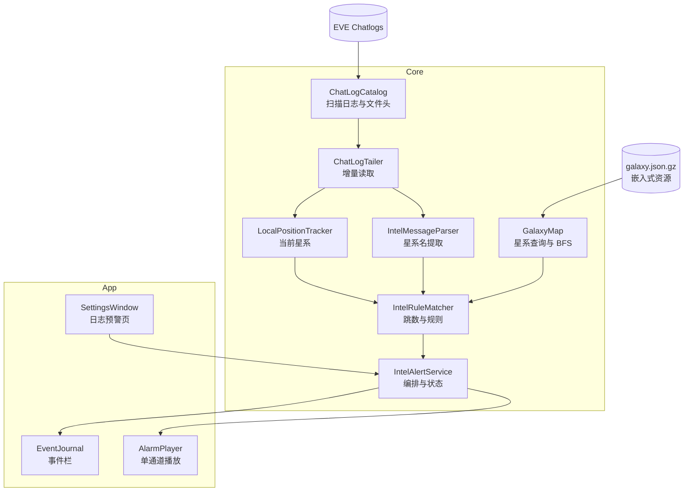
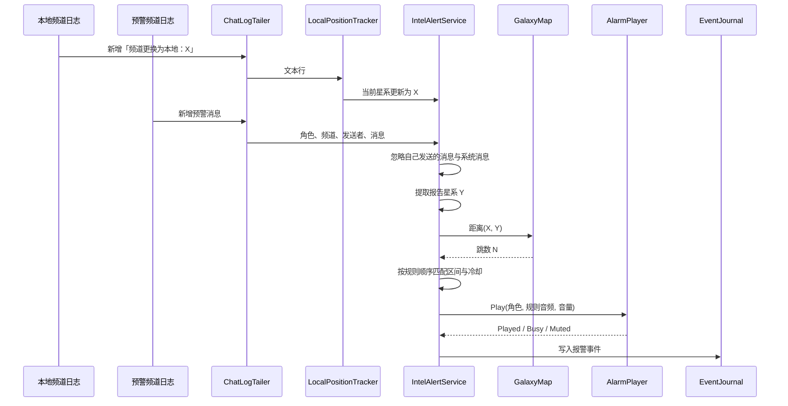

# EveWatch 日志预警与星系图本地化设计

项目：EveWatch　版本：v0.1　日期：2026-10-17　状态：待评审

---

## 1. 设计概述

### 1.1 目的与范围

本文档描述 EveWatch 新增的日志预警能力，以及支撑该能力的星系图本地化方案。

日志预警监听 EVE 客户端写出的聊天日志：从「本地」频道日志判断每个角色当前所在星系，从玩家选择的预警频道日志中提取被报告的星系名，计算两者之间的星门跳数，按用户配置的跳数区间播放对应报警音。

本文档覆盖：

- 星系图数据的来源、格式、体积、生成与加载方式
- 聊天日志目录定位、文件识别、增量读取与轮转处理
- 当前星系识别
- 预警消息解析、跳数计算、规则匹配、声音与事件
- 配置模型与设置界面
- 错误处理、性能约束、测试与实施阶段

不在本文档范围内：

- 虫洞、Ansiblex 跳桥、临时活动门等非星门连接
- 通过 ESI SSO 获取角色实时位置
- 预警频道的语义理解、敌我识别、舰队指挥逻辑
- 星域边界多边形与地图渲染资源
- 对游戏客户端进程的内存读取或输入注入

### 1.2 需求基线

需求来自本轮对话，以下条目作为设计输入。

| 编号 | 需求 | 状态 |
|---|---|---|
| IR-1 | 星系图数据全部本地化，运行时不依赖网络 | 已确认 |
| IR-2 | 使用本地频道日志或角色当前星系确定位置 | 已确认 |
| IR-3 | 监听预警频道日志，提取消息中的星系信息 | 已确认 |
| IR-4 | 用当前账号所在位置判断是否触发报警 | 已确认 |
| IR-5 | 跳数范围 1-N、N-N 可自定义，可添加多条（如 1-2、3-5、6-10），每档可选择不同报警音 | 已确认 |
| IR-6 | 预警频道按「角色 → 频道」配置 | 已确认 |
| IR-7 | 规则不设默认值，由用户自行添加 | 已确认 |
| IR-8 | ROI 报警优先于预警频道报警 | 已确认 |
| IR-9 | 同一星系重复提及使用 30 秒冷却 | 已确认 |
| IR-10 | 星系图本地化包含坐标 | 已确认 |

IR-7 意味着首次启用日志预警时不会自动产生任何报警，用户需要先添加至少一条规则和一个监听项。

### 1.3 设计目标与约束

| 编号 | 目标 | 指标 |
|---|---|---|
| IG-1 | 位置更新延迟 | 本地频道日志出现换星系行后 ≤ 2 秒完成更新 |
| IG-2 | 预警触发延迟 | 预警日志写入后 ≤ 2 秒完成判断与出声 |
| IG-3 | 常驻内存 | 星系图加载后新增占用 ≤ 20 MB，72 小时无增长 |
| IG-4 | CPU 占用 | 空闲轮询与日志增量读取合计 ≤ 0.5% 单核 |
| IG-5 | 运行权限 | 免管理员，只读取用户目录下的日志 |
| IG-6 | 失败隔离 | 星系图、日志或音频任一环节失败不影响 ROI 监控 |
| IG-7 | 数据体积 | 星系图资源压缩后 ≤ 0.35 MiB |

IG-3 与 IG-4 为设计目标，尚无量测数据，标记为 `[Hypothesis]`。IG-1 与 IG-2 的主要延迟来自游戏客户端写日志的缓冲，程序侧只负责轮询与解析 `[Expert judgment]`。

### 1.4 术语

| 术语 | 含义 |
|---|---|
| 本地频道 | EVE 客户端的 Local 频道，日志文件头中的 `Channel ID` 固定为 `local` |
| 预警频道 | 玩家加入的情报频道，例如 `fareast.imperium` |
| 监听项 | 一个「角色 → 预警频道」组合，对应一组日志文件 |
| 当前星系 | 某个角色最后一次出现在本地频道日志中的星系 |
| 报告星系 | 预警频道消息中被识别出的星系名 |
| 跳数 | 两个星系之间经过星门的最短路径长度，同星系为 0 |
| 规则 | 一个闭区间 `[minJumps, maxJumps]` 及对应的报警音与音量 |
| 冷却 | 同一角色与同一星系在指定时间内只触发一次报警 |

---

## 2. 总体架构

### 2.1 架构风格与理由

功能放在现有 Core 层，采用「轮询调度 + 独立后台处理 + 不可变配置快照」的结构。

聊天日志由游戏客户端异步追加，写入时机不受程序控制，使用固定间隔轮询比文件系统事件更稳定：文件系统事件可能重复、丢失或在网络盘上不可用，而轮询只需比较文件长度与已读偏移 `[Expert judgment]`。

所有解析与距离计算在后台线程完成，界面只读取状态快照。配置在启用或修改时转换成不可变快照，后台线程不直接读取可变的 `AppConfig` 对象，避免设置面板保存过程中出现半更新状态 `[Expert judgment]`。

星系图采用嵌入式压缩资源，不使用 SQLite 或外部数据库。数据只读、体积小、无查询服务需求，gzip 资源可以直接随程序发布，省去额外依赖与文件部署 `[Expert judgment]`。

### 2.2 架构图



图中各组件的关系如下。`ChatLogCatalog` 只负责发现日志文件并解析文件头，不读取消息正文。`ChatLogTailer` 维护每个文件的读取偏移，把新增行分别送给 `LocalPositionTracker` 与 `IntelMessageParser`。`IntelRuleMatcher` 从 `GalaxyMap` 取得跳数并匹配规则。`IntelAlertService` 是唯一对外入口，负责生命周期、配置快照、冷却状态与状态发布。设置界面只通过该服务读取状态和修改配置。

### 2.3 组件职责与边界

| 组件 | 职责 | 输入 | 输出 | 边界 |
|---|---|---|---|---|
| `ChatLogCatalog` | 定位日志目录，识别文件所属角色与频道 | 日志根目录 | `ChatLogFile` 列表 | 不读取消息、不判断内容 |
| `ChatLogTailer` | 增量读取单个日志文件 | 文件路径、偏移 | 新增文本行 | 不解析业务语义 |
| `LocalPositionTracker` | 从本地频道日志维护当前星系 | 本地日志新增行 | 当前星系变化事件 | 不处理预警频道 |
| `IntelMessageParser` | 从消息中提取星系名 | 聊天消息文本 | 星系名集合 | 不做跳数与规则判断 |
| `GalaxyMap` | 星系查询、BFS 跳数、距离缓存 | 星系名或 ID | 星系对象、跳数 | 不感知日志与报警 |
| `IntelRuleMatcher` | 规则匹配与冷却判断 | 当前星系、报告星系、规则 | 命中的规则与跳数 | 不播放声音 |
| `IntelAlertService` | 编排全部组件、发布状态 | 配置快照、日志事件 | 报警事件、状态快照 | 不直接操作界面控件 |

依赖方向为单向：`IntelAlertService` 依赖匹配器与跟踪器，匹配器依赖 `GalaxyMap`，日志组件不反向依赖报警组件。`GalaxyMap` 与日志组件之间没有依赖。

### 2.4 关键流程



流程中，位置更新与预警消息互不阻塞。当前星系未知时，预警消息仍会被解析，但不进入匹配与播放阶段，只在状态中记录「位置未知」。

---

## 3. 星系图本地化

### 3.1 数据来源与规模

数据来自 CCP 的 EVE SDE，通过 Fuzzwork 的 CSV 转换获取 `mapSolarSystems`、`mapSolarSystemJumps`、`mapRegions`、`mapConstellations` 四张表 `[Data-backed]`。

当前快照的规模：

| 项目 | 数量 |
|---|---|
| 星系总数 | 8,490 |
| k-space 星系 | 5,485 |
| J-space 星系 | 3,005 |
| 有向门跳记录 | 13,978 |
| 去重后的无向连接 | 6,989 |

J-space 星系保留在星系表中用于名称查询，但它们之间没有星门边，BFS 不会把虫洞当作连接 `[Data-backed]`。Thera 等拥有星门的特殊星系按 SDE 中的实际连边处理。

### 3.2 存储格式与体积

资源文件为 `src/EveWatch.Core/Data/galaxy.json.gz`，以 `EmbeddedResource` 打包。

结构采用并列数组，避免每个星系重复写字段名：

```json
{
  "version": 1,
  "generatedAt": "2026-10-17",
  "regions": [[10000025, "Immensea"]],
  "constellations": [[20000320, "WTE-CK"]],
  "systems": [
    [30002175, "2O-EEW", -0.761683, 10000025, 20000320, 42764303235130880, -7473596682696564, -248027061529640350]
  ],
  "edges": [[30002174, 30002175]]
}
```

`systems` 每项依次为：星系 ID、名称、安全等级、星域 ID、星座 ID、x、y、z。`edges` 为去重后的无向连接，每条连接只出现一次。

体积 `[Data-backed]`：

| 形态 | 体积 |
|---|---|
| 四张原始 CSV | 3.34 MiB |
| 仅图结构 JSON | 714 KiB |
| 仅图结构 gzip | 130 KiB |
| 含坐标 JSON | 预估 1.2–1.5 MiB `[Hypothesis]` |
| 含坐标 gzip | 预估 0.2–0.3 MiB `[Hypothesis]` |

最终数值以生成脚本的实际输出为准，生成后在构建日志中记录。

### 3.3 GalaxyMap 接口

```csharp
public sealed class GalaxyMap
{
    public static GalaxyMap LoadDefault();
    public static GalaxyMap Load(Stream stream);

    public IReadOnlyList<SolarSystem> Systems { get; }
    public SolarSystem? Find(string name);
    public SolarSystem? Find(int systemId);

    public IReadOnlyDictionary<int, int> DistancesFrom(int systemId, int maxDepth = 50);
    public int? Distance(int fromSystemId, int toSystemId, int maxDepth = 50);
}

public sealed record SolarSystem(
    int Id,
    string Name,
    double Security,
    int RegionId,
    string RegionName,
    int ConstellationId,
    string ConstellationName,
    double X,
    double Y,
    double Z);
```

名称查询使用大小写不敏感的字典，加载时建立一次。`DistancesFrom` 执行 BFS，返回从起点可达且深度不超过 `maxDepth` 的星系到起点的距离。`IntelRuleMatcher` 会按当前星系缓存距离表，当前星系变化时丢弃缓存。

`Distance` 用于设置界面的试跑与自检，不参与每条预警消息的热路径。

### 3.4 加载与缓存策略

`GalaxyMap` 在日志预警首次启用时加载，解析完成后常驻内存。未启用时不加载，不产生启动开销 `[Expert judgment]`。

每个监听项只需当前星系的距离表。8,490 个节点与 6,989 条边的 BFS 在毫秒量级，不需要预计算全源最短路径 `[Expert judgment]`。距离表使用 `Dictionary<int,int>`，单份占用约数百 KB；监听项数量按个位数设计，总占用仍在 IG-3 范围内 `[Hypothesis]`。

资源缺失或解析失败时，日志预警进入不可用状态，向事件栏写入错误，ROI 监控继续运行。

### 3.5 数据再生成

仓库提供一个生成脚本 `tools/build-galaxy-data.js`，输入 SDE 的 CSV 目录，输出 `galaxy.json.gz`。脚本执行以下步骤：

1. 读取四张 CSV，建立星系、星域、星座索引。
2. 合并门跳记录，按「较小 ID-较大 ID」去重为无向边。
3. 按固定字段顺序输出紧凑 JSON。
4. 使用 gzip 压缩并写入目标目录。
5. 打印星系数、连接数与压缩体积，便于与本文档记录值比对。

EVE 版本更新导致星系数或连接变化时，重新运行脚本并提交新的资源文件。生成脚本不参与程序运行时。

---

## 4. 日志监听与位置识别

### 4.1 日志目录与文件格式

聊天日志默认位于：

```text
%USERPROFILE%\Documents\EVE\logs\Chatlogs
```

本机实测的目录与文件格式 `[Data-backed]`：

- 文件名：`<频道显示名>_<yyyyMMdd>_<HHmmss>_<角色ID>.txt`
- 文件头包含 `Channel ID`、`Channel Name`、`Listener`、`Session started`
- 本地频道文件头的 `Channel ID` 为 `local`，中文客户端的 `Channel Name` 为「本地」
- 换星系行：`[ 2026.10.17 11:31:58 ] EVE系统 > 频道更换为本地：2O-EEW*`
- 普通消息行：`[ 2026.10.17 12:01:42 ] Nightmarepro > 864-rdr`
- 预警消息示例：`[ 2026.10.17 11:32:53 ] Mirid Tzash > PT-21C*  Tired Sleepy  tm3k`

频道显示名会随客户端语言变化，`Channel ID` 与文件名末段角色 ID 不随语言变化。识别逻辑以 `Channel ID` 和角色 ID 为准，不使用频道显示名做匹配。

### 4.2 日志目录定位

按以下顺序寻找可用目录：

1. 配置中手动指定的目录
2. 系统「文档」已知文件夹：`<文档>\EVE\logs\Chatlogs`（会跟随 OneDrive 或手动重定向）
3. 注册表 `User Shell Folders` / `Shell Folders` 中的 `Personal` 路径 + `EVE\logs\Chatlogs`
4. `%USERPROFILE%\Documents\EVE\logs\Chatlogs`
5. `%USERPROFILE%\OneDrive\Documents\EVE\logs\Chatlogs`
6. `%USERPROFILE%\OneDrive\文档\EVE\logs\Chatlogs`
7. 环境变量 `OneDrive` / `OneDriveConsumer` / `OneDriveCommercial` 下的 `Documents`、`文档` 或根目录
8. 固定磁盘兜底：逐一检查 `X:\Documents`、`X:\文档`、`X:\我的文档`、`X:\Users\<当前用户>\Documents`、`X:\EVE`、`X:\OneDrive*\Documents|文档` 下的 `EVE\logs\Chatlogs`
9. 仍未找到时，再扫描各固定/可移动磁盘的一级目录：`X:\<任意文件夹>\EVE\logs\Chatlogs`，覆盖文档被手动移到 `D:\个人文档` 这类情况

找到第一个包含 `.txt` 文件的目录即采用。设置界面允许手动选择目录并写回配置。目录不存在时，日志预警状态显示「未找到聊天日志目录」，同时给出默认位置并提示：先在游戏里打开任意聊天频道生成日志，或点「浏览」手动选择 `EVE\logs\Chatlogs`；此时不启动监听。

### 4.3 文件目录与角色频道映射

`ChatLogCatalog` 扫描最近 30 天修改过的 `.txt` 文件，只解析文件头，生成 `ChatLogFile`：

```csharp
public sealed record ChatLogFile(
    string Path,
    long CharacterId,
    string CharacterName,
    string ChannelId,
    string ChannelName,
    DateTime LastWriteTime,
    long Length);
```

角色 ID 来自文件名末段，角色名来自 `Listener`。频道 ID 来自 `Channel ID`。文件头解析失败的文件跳过，不中断扫描。

目录结果用于两件事：

- 设置界面列出可选角色与频道
- 运行时为每个监听项找到最新的日志文件

「角色 → 频道」的选择只展示该角色实际产生过日志的频道，排除 `local`。同一个频道可能出现在多个角色下，每个组合是独立监听项。

### 4.4 增量读取与轮转

`ChatLogTailer` 为每个文件维护读取偏移，使用 `FileShare.ReadWrite | FileShare.Delete` 打开，避免锁住游戏正在写的文件。

轮询间隔为 1 秒。每次轮询：

1. 比较文件当前长度与已读偏移。
2. 长度增加时读取新增字节，按行切分，保留不完整的一行到下一次。
3. 长度小于已读偏移时视为文件被截断，偏移归零并重新读取。
4. 监听项对应文件被替换时，关闭旧文件、打开新文件；本地频道从头解析新文件以取得当前星系，预警频道从新文件末尾开始，避免重放历史消息。

只读取新增内容，历史行不重复处理。解析失败的行跳过，不抛异常。

### 4.5 当前星系识别

`LocalPositionTracker` 为每个角色维护当前星系：

- 启动时读取该角色最新的本地频道文件，找到最后一条换星系行
- 运行时只处理新增行
- 匹配中文与英文两种形式：
  - `频道更换为本地：<星系>`
  - `Channel changed to Local : <星系>`
- 去掉星系名末尾的 `*` 与首尾空白
- 通过 `GalaxyMap.Find` 验证名称有效，无效名称记录警告并保持原位置

当前星系变化后，`IntelAlertService` 通知 `IntelRuleMatcher` 丢弃该监听项的距离缓存。

找不到本地频道文件、文件没有换星系行或星系名无法识别时，状态为「位置未知」。位置未知期间不播放预警音，避免用错误位置产生误报。

### 4.6 频道发现与手动输入

频道列表来自聊天日志文件头，不是客户端实时频道列表。程序在不读取游戏内存的前提下无法枚举角色当前加入的全部频道，能列出的是最近 30 天内产生过日志的频道。

文件头提供 `Channel ID`、`Channel Name`、`Listener`。按频道类型区分：

| 类型 | Channel ID 形式 | 稳定性 | 匹配方式 |
|---|---|---|---|
| 本地频道 | `local` | 固定 | 排除，不用于预警 |
| 玩家频道 / 私聊 | `player_<hash>` | 稳定 | 按 Channel ID 匹配 |
| 舰队频道 | `fleet_<数字>` | 每次舰队不同 | 按频道名匹配最新日志 |

「频道探测」按角色列出日志中发现的频道，显示名称、Channel ID、类型与最近活跃时间。舰队频道显示为「舰队」，并标记为动态频道。

手动输入支持频道名或 Channel ID，解析顺序为：

1. Channel ID 精确匹配
2. 频道名精确匹配
3. 同名频道有多条日志时取最近一条
4. 都未找到时建立「等待日志」监听项

「等待日志」项会在每次目录扫描时重试，出现匹配日志后自动绑定，不需要用户再次操作。舰队频道始终跟随该角色最新的 `fleet_*` 日志；加入新舰队后自动切换到新频道文件。如果频道显示名发生变化，需要重新选择。

一个角色可以添加多条监听项，每条对应一个频道。所有监听项共用该角色的当前星系，但各自独立读取频道消息。

### 4.7 监听生命周期

启用日志预警后：

1. `ChatLogCatalog` 扫描目录，建立角色与频道索引。
2. 为每个启用的监听项定位本地频道文件与预警频道文件。
3. 启动轮询线程；没有可用文件时进入等待状态，下次扫描重试。
4. 配置修改或监听项增删时，重建监听项并保留未变化文件的读取偏移。
5. 关闭功能时停止轮询并释放文件句柄。

日志预警与 ROI 监控互不依赖。ROI 监控停止时，日志预警仍可工作。

---

## 5. 预警解析与规则触发

### 5.1 消息解析

`IntelMessageParser` 接收一行消息，输出命中的星系集合。

处理步骤：

1. 跳过文件头、空行与 MOTD 行。MOTD 由 `EVE系统` 或 `EVE System` 发送，内容以 `频道置顶信息` 或 `Channel MOTD` 开头。
2. 跳过发送者等于当前监听角色名的消息。默认开启，配置项为 `ignoreSelf`。
3. 消息正文包含独立单词 `clr`（大小写不敏感）时视为区域安全，直接跳过，即使同时带有星系名也不报警。
4. 从 `[ 时间戳 ] 发送者 > 消息` 中取出消息正文。
5. 将正文按空白与标点切分为候选词，保留连字符、下划线、数字与字母。去掉词尾的 `*`、`,`、`.`、`!`、`?`、括号。
6. 用候选词查星系名称字典，大小写不敏感。
7. 返回命中星系，按出现顺序去重。

一条消息命中多个星系时，匹配阶段只取距离最近的一个，避免一次消息连续播放多个声音。

缩写、拼写错误、用星门两端简写代替完整星系名的消息无法识别。这类消息不产生报警，属于已知限制。

### 5.2 跳数计算与规则匹配

规则区间为闭区间 `[minJumps, maxJumps]`，允许 0 跳。规则由用户自行添加，可同时存在多条，例如 `1-2`、`3-5`、`6-10`，每档可以配置不同声音。规则按设置界面的排列顺序依次判断，第一条命中的规则生效。

`IntelRuleMatcher` 对每条预警消息执行：

1. 若当前星系未知，返回「位置未知」结果。
2. 对每个命中的报告星系，用当前星系的距离表取得跳数。
3. 过滤掉不在任何启用规则区间内的星系。
4. 在剩余候选中取跳数最小的星系。
5. 从第一条规则开始，选择包含该跳数的第一条启用规则。
6. 检查冷却：键为角色 ID 与星系 ID，30 秒内重复出现则跳过。
7. 返回命中的角色、频道、报告星系、跳数、规则。

区间重叠时先出现的规则优先。设置界面会对重叠区间显示提示，但不阻止保存。例如 `2-5` 与 `5-10` 在 5 跳重叠，5 跳使用排在前面的 `2-5` 规则。

### 5.3 声音与事件

预警音复用现有 `AlarmPlayer` 与 `AlarmSetting` 结构。每条规则可以引用内置预设或自定义音频文件，并单独设置音量。

播放语义：

- 调用 `AlarmPlayer.Play(key, alarm, volume)`，不抢占当前声音
- ROI 报警正在播放时返回 `Busy`，本次不出声，但事件照常写入
- 全局静音时返回 `Muted`，事件照常写入
- 音频文件不存在或音频设备不可用时返回 `Failed`，事件中写明原因

播放键单条使用 `intel:{characterId}`，批次使用 `intel:batch:{batchId}`，与 ROI 的账号键区分。

事件写入 `EventJournal`，类型为 `Alarm`，账号为监听角色名，正文包含频道、星系与跳数，备注包含规则区间和播放结果。事件栏现有的条数上限继续生效。

### 5.4 冷却与去重

冷却状态保存在 `IntelAlertService` 内存中，键为 `(characterId, systemId)`，默认 30 秒，可由配置修改，范围 0–600 秒。

多个监听项监听同一个频道时，同一行消息可能被多个角色各处理一次。每个角色按自己的当前位置计算跳数，随后进入批次合并流程，详见 5.5。

日志预警重启或程序重启后冷却清空，允许重新报警。

### 5.5 多账号同时触发与批次播报

多个账号在短时间内先后命中时，不逐个播放声音，而是合并为一个批次统一播报。

批次窗口为 1.2 秒。第一条命中开始计时，窗口内到达的触发全部收集，窗口结束时结算 `[Expert judgment]`。这样既能把几乎同时发生的报警合并，也不会让单条报警等待过久。

合并规则：

| 情况 | 处理 |
|---|---|
| 同一角色与同一星系在 30 秒冷却内 | 直接丢弃 |
| 同一条预警消息被多个角色读到 | 合并为一条，保留多个角色及各自跳数 |
| 同一星系被多个预警频道报告 | 合并为一条，频道名并列 |
| 同一角色同时命中多条规则 | 按规则顺序取第一条，只算一条 |
| 不同角色报告不同星系 | 保留为多条 |

批次内按跳数升序排列，跳数相同按命中时间先后排列。跳数最小的条目视为最紧急。

一个批次只播放一次声音，使用最紧急条目所命中的规则声音。例如批次内同时出现 1 跳、3 跳、5 跳三个条目，且分别命中不同规则，播放 1 跳条目的规则声音，另外两个条目只展示。

弹窗展示：

- 标题显示「INTEL ALERT · N 个账号」
- 标题下方显示原始预警内容，例如 `7YSF-E+13`
- 主图默认跟随最新到达的条目；列表按命中时间倒序，最新的条目在最上方
- 主图下方列出批次条目：账号、警报星系、跳数、频道
- 点击条目切换主图与该条目的规则信息
- 条目超过 5 条时显示「+N」，弹窗高度保持稳定

批次显示期间又收到新触发时，新条目并入当前批次，主图切换到最新条目并重置自动关闭倒计时。声音仍只在新条目比当前最紧急条目更近时补播一次；否则只更新列表 `[Expert judgment]`。

ROI 报警仍然优先。ROI 正在播放时，批次不出声，弹窗与事件照常产生。

### 5.6 多条路径与多频道报告

一个警报星系只触发一次报警，不因为存在多条星门路线而重复计数。

跳数取当前星系到警报星系的最短路径长度。BFS 只返回一个最短路径；存在多条等长路径时，按星系 ID 升序选择一条，并在界面标注「等长路线 N 条」`[Expert judgment]`。

路径展示：

- 主图默认绘制最短路径，实线琥珀色
- 其他可达路线如果也落在规则区间内，显示「另有 N 条备选路线」入口
- 展开后在路线视图下方以虚线追加一条备选路线；邻域视图则直接以虚线边叠加
- 备选路线不改变报警结论、跳数和声音

同一星系被多个预警频道报告时，按「角色 + 星系」冷却键合并。弹窗只出现一条，频道名并列显示，30 秒内只响一次。

如果备选路线超出规则的最大跳数，它不参与触发，也不在入口中列出。

---

## 6. 配置与数据模型

### 6.1 配置结构

在 `AppConfig` 中新增 `Intel` 节点，随 `evewatch.json` 持久化：

```json
"intel": {
  "enabled": true,
  "chatLogDirectory": "",
  "cooldownMs": 30000,
  "batchWindowMs": 1200,
  "ignoreSelf": true,
  "listeners": [
    {
      "characterId": 2122365291,
      "characterName": "TieTouWa A",
      "channelId": "player_51799e615e6811f0ada800109bd0f828",
      "channelName": "fareast.imperium",
      "enabled": true
    }
  ],
  "rules": [
    {
      "minJumps": 0,
      "maxJumps": 0,
      "enabled": true,
      "alarm": { "kind": "preset", "id": "alarm" },
      "volume": 80
    },
    {
      "minJumps": 1,
      "maxJumps": 2,
      "enabled": true,
      "alarm": { "kind": "preset", "id": "beep" },
      "volume": 80
    },
    {
      "minJumps": 3,
      "maxJumps": 5,
      "enabled": true,
      "alarm": { "kind": "preset", "id": "buzz" },
      "volume": 80
    },
    {
      "minJumps": 6,
      "maxJumps": 10,
      "enabled": true,
      "alarm": { "kind": "preset", "id": "mech" },
      "volume": 70
    }
  ]
}
```

模型定义：

```csharp
public sealed class IntelOptions
{
    public bool Enabled { get; set; }
    public string ChatLogDirectory { get; set; } = string.Empty;
    public int CooldownMs { get; set; } = 30000;
    public int BatchWindowMs { get; set; } = 1200;
    public bool IgnoreSelf { get; set; } = true;
    public List<IntelListener> Listeners { get; set; } = [];
    public List<IntelRule> Rules { get; set; } = [];
}

public sealed class IntelListener
{
    public long CharacterId { get; set; }
    public string CharacterName { get; set; } = string.Empty;
    public string ChannelId { get; set; } = string.Empty;
    public string ChannelName { get; set; } = string.Empty;
    public bool Enabled { get; set; } = true;
}

public sealed class IntelRule
{
    public int MinJumps { get; set; }
    public int MaxJumps { get; set; }
    public bool Enabled { get; set; } = true;
    public AlarmSetting Alarm { get; set; } = new();
    public int Volume { get; set; } = 80;
}
```

### 6.2 校验规则

`AppConfig.Normalize` 对新增节点执行：

- `Intel` 为空时创建默认对象，`Enabled` 为 false
- `CooldownMs` 夹紧到 0–600000
- `BatchWindowMs` 夹紧到 500–5000，默认 1200
- `Volume` 夹紧到 0–100
- `MinJumps` 夹紧到 0–100，`MaxJumps` 夹紧到 0–100
- `MaxJumps < MinJumps` 的规则丢弃
- `Alarm` 为空时补默认预设；预设 ID 不存在时回退到 `alarm`
- `Listeners` 按 `(CharacterId, ChannelId)` 去重，空频道 ID 的项丢弃
- 规则顺序保持不变，顺序即优先级
- 不自动合并重叠区间，由设置界面提示

配置保存沿用现有 700 毫秒防抖出口，不新增保存路径。

### 6.3 运行状态

`IntelAlertService` 向设置界面发布只读状态快照：

```csharp
public sealed record IntelStatus(
    bool Running,
    string? ChatLogDirectory,
    string? Error,
    IReadOnlyList<IntelListenerStatus> Listeners);

public sealed record IntelListenerStatus(
    long CharacterId,
    string CharacterName,
    string ChannelName,
    string? CurrentSystem,
    bool PositionKnown,
    DateTime? LastMessageAt,
    string State);
```

`State` 取值包括「监听中」「位置未知」「等待日志」「文件缺失」「已停用」。界面每秒刷新一次状态，不直接读取服务内部集合。

---

## 7. 设置界面

### 7.1 入口与窗口结构

- 快捷键：保留在 `SettingsWindow`，由主工具栏齿轮按钮打开。
- 频道预警：新增独立窗口 `IntelSettingsWindow`，由主工具栏「频道预警」按钮打开，不放在设置面板内。

窗口使用固定尺寸并允许内容区域滚动。关闭频道预警窗口不会停止监听。

### 7.2 规则表

每行包含：

| 列 | 控件 | 约束 |
|---|---|---|
| 顺序 | 序号 + 上移 / 下移 | 调整规则优先级 |
| 起始跳数 | 数字输入 | 0–100 |
| 结束跳数 | 数字输入 | ≥ 起始跳数 |
| 报警声音 | 下拉框 | 五个内置预设 + 「自定义文件」 |
| 音量 | 滑块 | 0–100 |
| 试听 | 按钮 | 播放当前行音频，不写事件 |
| 启用 | 开关 | 关闭后不参与匹配 |
| 删除 | 按钮 | 删除后立即保存 |

底部提供「添加规则」。新规则默认取上一行最大跳数 +1 到 +3，声音为默认预设，音量为 80，用户可再修改。规则数量不设硬上限，超出页面高度时由页面滚动承载。

首次启用日志预警时规则列表为空，由用户自行添加；原型中的 0-0、1-2、3-5、6-10 仅用于演示。

示例配置：

| 顺序 | 跳数区间 | 报警声音 | 音量 |
|---|---|---|---|
| 01 | 0–0 | 警报长鸣 | 80% |
| 02 | 1–2 | 短促嘀声 | 80% |
| 03 | 3–5 | 低沉蜂鸣 | 80% |
| 04 | 6–10 | 机械提示 | 70% |

区间重叠时该行左侧显示琥珀色标记并提供提示，但允许保存。列表顺序即优先级，可用上移 / 下移调整。

规则表下方显示匹配顺序说明：从上到下依次判断，先命中先生效。

### 7.3 监听表

每行是一个「角色 + 频道」监听项。同一个角色可以出现多行，分别监听不同频道；所有行共用该角色的当前星系。

| 列 | 内容 |
|---|---|
| 角色 | 角色名 + ID |
| 频道 | 频道显示名 + Channel ID；舰队频道标记为「动态」 |
| 类型 | 玩家频道 / 私聊 / 舰队频道 / 手动输入 |
| 当前星系 | 运行时状态，未知时显示「位置未知」 |
| 状态 | 监听中 / 等待日志 / 文件缺失 / 已停用 |
| 启用 | 开关 |
| 删除 | 按钮 |

「添加监听」打开对话框：

1. 从最近 30 天的日志中列出角色
2. 选择角色后，列出该角色日志中发现的非本地频道，显示名称、Channel ID、类型与最近活跃时间
3. 可以多选频道，一次添加多条监听
4. 也可以手动输入频道名或 Channel ID
5. 确认后立即保存；无法解析的频道保存为「等待日志」，出现匹配日志后自动绑定

同一个角色与频道不能重复添加。舰队频道按名字跟随该角色最新的 `fleet_*` 日志，不固定 Channel ID。

对话框提供「重新扫描」按钮，重新读取最近日志并刷新频道列表。「频道探测」可以在添加前查看某角色当前星系、最近一条消息与命中预览。

### 7.4 试跑与状态反馈

页面顶部显示：

- 启用开关
- 聊天日志目录（自动检测结果或手动路径）与「选择目录」按钮
- 运行状态：未启用 / 监听中 / 未找到日志目录 / 星系图加载失败

提供「最近 100 条消息试跑」按钮。试跑只读取选定监听项最近的消息，输出每条消息识别出的星系、跳数与命中的规则，不播放声音、不写事件。该功能用于确认频道内容与匹配效果，不参与后台运行。

### 7.5 置顶关联图窗口

命中日志预警后弹出一个独立的置顶窗口，行为与 ROI 并排窗一致：Topmost、无边框、不进入任务栏、可拖动，不抢 EVE 客户端焦点 `[Expert judgment]`。

窗口结构：

- 标题区：警报图标、批次数量、警报星系、跳数、角色、频道、时间
- 图形区：最短星门路径，或 5 跳邻域关联图
- 信息区：命中规则、报警声音、星域、安全等级
- 批次列表：多账号触发时列出每条报警，点击切换主图
- 底部：自动关闭倒计时、复制星系、切到角色

多账号批次在主图下方显示条目列表，按命中时间倒序排列，最新的在最上方。选中条目使用琥珀色边框；主图、规则与声音信息随选中条目更新。条目超过 5 条时显示「+N」，窗口高度不变。

备选路线入口只在存在备选路径时出现。路线视图展开后，在最短路径下方追加一条虚线路线；邻域视图展开后，用虚线边叠加备选路径。备选路线不改变跳数、声音与报警结论。

窗口设置放在频道预警窗口的「弹窗设置」分组：

| 设置项 | 取值 |
|---|---|
| 启用弹窗 | 开 / 关 |
| 显示模式 | 路线 / 邻域 |
| 窗口尺寸 | 紧凑 / 标准 / 大 |
| 不透明度 | 65%–100% |
| 自动关闭 | 5 秒 / 10 秒 / 30 秒 / 不自动 |
| 弹出位置 | 锚点（四角 / 居中 / ROI 并排窗旁）+ 指定显示器；自定义（拖拽 / X-Y） |
| 置顶显示 | 开 / 关 |
| 显示内容 | 星域、安全等级、频道、角色、声音 |

自动关闭默认 10 秒，鼠标悬停或操作批次列表时暂停。关闭按钮只关闭弹窗，不删除事件栏记录，也不改变日志预警的启用状态。

### 7.6 弹窗位置与持久化

位置支持锚点与自定义两种模式。

锚点模式在每次显示时按目标显示器的工作区和窗口实际尺寸重新计算，不保存绝对坐标。可选锚点：

- 主屏或指定显示器的左上、右上、左下、右下
- 屏幕居中
- ROI 并排窗旁：以并排窗边界为参照，优先放在右侧，空间不足时放左侧；并排窗未打开时退回所选显示器的右侧

自定义模式保存窗口左上角坐标。用户按住右键拖动弹窗（标题、图形或空白处均可）松手后，位置立即写入界面状态；标题栏左键拖动与设置里输入 X / Y 坐标同样有效。自定义位置在每次报警时沿用，不会因为弹窗重新显示而回到锚点。

显示器处理：

- 设置里列出 `Screen.AllScreens`，显示显示器型号名称（读取 EDID）、分辨率与主屏标记
- 锚点模式使用所选显示器的工作区
- 自定义模式记录窗口中心所在的显示器
- 恢复时如果目标显示器已不存在，退回主屏右上角并写一条警告
- 坐标夹紧到可见范围：至少保留 40 DIP 在屏幕内，避免拔掉显示器或修改分辨率后窗口消失

持久化写入 `%APPDATA%\EveWatch\evewatch.ui.json` 的 `intelAlertWindow` 节点，不写入 `evewatch.json`。保存时机为拖动结束与设置修改，不随每次报警写入。

```json
"intelAlertWindow": {
  "positionMode": "anchor",
  "anchor": "top-right",
  "monitor": "\\\\.\\DISPLAY1",
  "placement": { "left": 1320, "top": 180 },
  "size": "standard",
  "opacity": 1.0,
  "autoCloseSeconds": 10,
  "topmost": true,
  "viewMode": "route"
}
```

`positionMode` 为 `anchor` 时忽略 `placement`；为 `custom` 时使用 `placement`。`opacity` 夹紧到 0.65–1.0，`autoCloseSeconds` 允许 0、5、10、30，`size` 允许 `compact`、`standard`、`large`，`viewMode` 允许 `route`、`neighborhood`。

拖动时坐标换算复用 ROI 并排窗的做法：`PointToScreen` 得到设备像素，再按 `VisualTreeHelper.GetDpi(this)` 换算为 WPF 单位。跨 DPI 显示器恢复时，按目标显示器的工作区与 DPI 换算后再设置 `Left` / `Top`。

设置界面提供：

- 位置模式：锚点 / 自定义
- 锚点：四角 / 居中 / ROI 并排窗旁
- 显示器：主屏 / 各扩展屏
- 自定义坐标：X、Y 输入框与「使用当前位置」按钮
- 「恢复默认位置」按钮，回到主屏右上角

---

## 8. 错误处理与边界

| 场景 | 处理 |
|---|---|
| 聊天日志目录不存在 | 状态显示「未找到聊天日志目录」，不抛异常，下次扫描重试 |
| 日志文件被游戏占用 | 使用共享读打开；失败时记录一次警告并下次重试 |
| 文件轮转或截断 | 重新定位最新文件，偏移归零；本地频道重新解析当前位置 |
| 文件头损坏 | 跳过该文件，不影响其他文件 |
| 本地频道没有换星系行 | 位置未知，不触发报警 |
| 星系名不在星系表 | 忽略该候选词，记录调试信息 |
| 同一消息命中多个星系 | 取跳数最小的一个，只报警一次 |
| 规则区间重叠 | 按顺序先命中先生效，界面提示 |
| 规则列表为空 | 不触发任何报警，状态正常 |
| 监听项为空 | 不启动轮询，状态显示「未配置监听」 |
| 星系图资源损坏 | 日志预警不可用，事件栏写错误，ROI 监控不受影响 |
| 音频文件丢失 | 报警事件写入，备注写明文件不可用 |
| 全局静音 | 不播放声音，事件照常写入 |
| ROI 报警占用通道 | 本次预警让位，事件写明「ROI 报警占用」 |
| 多个角色监听同一频道 | 各监听项独立判断，声音由单通道让位机制处理 |

日志读取与分析线程的异常在循环内捕获，单次失败只影响当前轮询，不终止服务。配置加载失败沿用现有回退策略。

---

## 9. 非功能设计、影响与验证

### 9.1 性能与内存

| 项目 | 设计 |
|---|---|
| 日志轮询 | 1 秒一次，只 stat 文件与读取新增字节 |
| 文件扫描 | 启动时扫描最近 30 天；运行时只处理已识别文件，新增文件按需解析 |
| 消息解析 | 每条消息按空白切词，词数通常在 50 以内；星系字典查找为 O(1) |
| 跳数计算 | 每个当前星系构建一次距离表，后续查询为 O(1) |
| 星系图内存 | 解析后常驻；目标新增 ≤ 20 MB `[Hypothesis]` |
| 日志内存 | 只保留读取偏移与当前不完整行，不缓存历史消息 |
| 冷却状态 | 每个角色 + 星系一个时间戳，按需清理过期项 |

8,490 个节点与 6,989 条边的 BFS 在毫秒级完成 `[Expert judgment]`。日志行解析与查找的成本远低于一次 WGC 取帧，不会影响 ROI 监控的 CPU 目标。

### 9.2 兼容与迁移

- `AppConfig` 新增 `Intel` 节点，旧配置文件缺少该节点时由 `Normalize` 补默认值，不需要手动迁移
- 程序二进制增加星系图资源，压缩后不超过 0.35 MiB
- 现有 ROI 监控、设置同步、快捷键、账号列表逻辑不修改
- `SettingsWindow` 只保留快捷键；频道预警使用独立窗口，配置结构不变
- 日志预警默认关闭，升级后不会突然产生声音
- 事件栏继续使用现有 200 条界面上限与 500 条内存上限

### 9.3 测试与验收

测试数据使用本机真实日志：

- 本地频道样本：`C:\Users\<user>\Documents\EVE\logs\Chatlogs\本地_20261017_113153_2122365291.txt`，预期当前星系为 `2O-EEW`
- 预警频道样本：`C:\Users\<user>\Documents\EVE\logs\Chatlogs\fareast.imperium_20261017_113157_2122179223.txt`，用于验证消息切词与星系识别
- 跳数抽样：用 ESI 航线接口验证 `2O-EEW → J-QA7I` 为 1 跳、`→ Y-FZ5N` 为 3 跳、`→ S-9RCJ` 为 5 跳、`→ AC-7LZ` 为 5 跳
- 多账号批次：构造 1 跳、2 跳、3 跳三条报警，验证只播放一次最紧急规则声音，列表合并正确
- 多路径：验证 `2O-EEW → Y-FZ5N` 的 3 跳最短路线与 4 跳备选路线只触发一次

验收标准：

| 编号 | 标准 |
|---|---|
| AC-1 | 启用后 2 秒内识别本地频道中的当前星系，状态显示正确 |
| AC-2 | 换星系行出现后 2 秒内更新当前星系 |
| AC-3 | 预警消息写入后 2 秒内完成识别、距离计算与规则判断 |
| AC-4 | 命中规则时播放该规则配置的声音与音量 |
| AC-5 | 同一角色同一星系 30 秒内只播放一次 |
| AC-6 | ROI 报警播放期间，预警音让位且事件仍写入 |
| AC-7 | 全局静音时不出声，事件仍写入 |
| AC-8 | 位置未知或规则为空时不出声，状态可解释 |
| AC-9 | 文件轮转、截断、日志目录缺失时服务不崩溃并能恢复 |
| AC-10 | 关闭日志预警后不再读取日志、不再报警 |
| AC-11 | 连续运行 72 小时内存无持续增长，日志预警开关切换后文件句柄释放 |
| AC-12 | 星系图加载失败时 ROI 监控与设置同步仍正常 |
| AC-13 | 1.2 秒窗口内的多账号触发合并为一批，只播放一次最紧急规则声音 |
| AC-14 | 批次弹窗列出全部条目，点击条目可切换主图，同星系多频道报告合并显示 |
| AC-15 | 同一星系存在多条路线时只触发一次，最短路径实线展示，备选路线可叠加为虚线 |
| AC-16 | 批次显示期间新触发并入当前弹窗并重置倒计时，声音不重复叠加 |
| AC-17 | 规则可添加多条（如 1-2、3-5、6-10），可上移 / 下移调整优先级，重叠区间有提示且按顺序生效 |
| AC-18 | 可按角色列出最近日志中的频道，支持多选与手动输入；未解析频道进入「等待日志」并自动绑定；舰队频道跟随最新 `fleet_*` 日志 |
| AC-19 | 弹窗位置支持锚点与自定义；拖动或设置后写入 `evewatch.ui.json`，重启后恢复；显示器移除或分辨率变化时回退可见位置 |

### 9.4 实施阶段

| 阶段 | 内容 | 完成标志 |
|---|---|---|
| 1 | 星系图生成脚本、嵌入式资源、`GalaxyMap` | 能按名称查星系并算出 5 跳邻域，抽样跳数与 ESI 一致 |
| 2 | 日志目录扫描、文件头解析、增量读取、本地位置跟踪 | 设置界面能列出角色与频道，状态显示当前星系 |
| 3 | 消息解析、规则匹配、冷却、声音与事件 | 用真实日志试跑能得到预期的星系与跳数 |
| 4 | 设置界面规则表、监听表、添加监听、试跑 | 能完成配置并立即生效，无需重启 |
| 5 | 回归测试与 72 小时稳定性观察 | AC-1 至 AC-19 全部通过 |

阶段 1 与阶段 2 可以并行。阶段 3 依赖前两个阶段。阶段 4 在阶段 3 的接口稳定后开始。

### 9.5 待确认项

- 预警频道消息中的星系缩写是否需要别名表。当前不支持 `y-n` 这类缩写 `[Hypothesis]`。
- 是否需要在设置界面提供「手动指定当前星系」作为日志缺失时的兜底。当前设计只显示位置未知并停止报警 `[Hypothesis]`。
